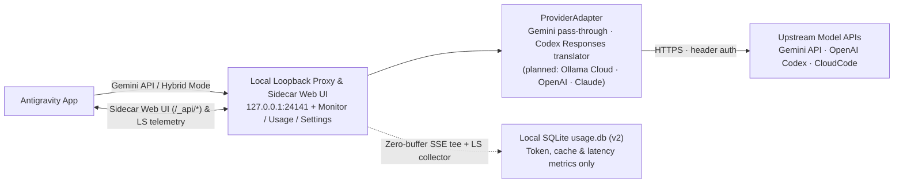

# Contributing to Antigravity Companion

Thanks for helping improve `agy-companion`! For large changes or new provider adapters, please open an issue first so we can align on the approach before you write code.

## Prerequisites

- **Rust** — stable toolchain supporting `edition = "2024"` (`rustfmt`, `clippy`).
- **Node.js** `>= 18` — builds the embedded Sidecar Web UI in `ui/`.
- **Python** `>= 3.11` — runs the stdlib-only E2E suite in `e2e/` (no `pip` packages needed).
- **Antigravity CLI (`agy`)** *(optional)* — used for `agy plugin validate --strict ./plugin` and live testing.

## Build from Source

```bash
# Build UI + Rust debug binary and symlink ./plugin for local Antigravity testing
./scripts/dev-install.sh

# Or run the full installer directly from source
cargo run -p companion-cli -- install

# Or run the loopback proxy in the foreground
cargo run -p companion-cli -- serve
```

To iterate on the Sidecar Web UI without rebuilding Rust, point `AGY_COMPANION_UI_HTML` at the built bundle, rebuild, and reopen the panel:

```bash
export AGY_COMPANION_UI_HTML="$(pwd)/ui/dist/index.html"
npm --prefix ui run build
```

See [`.agents/skills/local-dev/SKILL.md`](.agents/skills/local-dev/SKILL.md) for sidecar logs and live reload tips.

## Running Checks & Tests

```bash
# Primary verification gate (fmt, clippy, Rust tests, UI checks, plugin validation)
./scripts/agent_check.sh

# UI typecheck, tests, and bundle build (when editing ui/src/)
npm --prefix ui ci && npm --prefix ui run typecheck && npm --prefix ui test && npm --prefix ui run build

# Opaque-box E2E suite (-B avoids __pycache__)
cargo build -p companion-cli
python3 -B e2e/run_e2e.py --suite all --workers 4 --binary target/debug/agy-companion --repo-root . -v
```

## Architecture & Layout



| Path | Description |
| --- | --- |
| [`crates/companion-core/`](crates/companion-core/README.md) | Config schema, `auth/` credential store, model catalogs, redaction, SQLite usage sink, shell hooks |
| [`crates/companion-providers/`](crates/companion-providers/README.md) | `ProviderAdapter` trait, Gemini & OpenAI Codex providers, Antigravity LS RPC client |
| [`crates/companion-proxy/`](crates/companion-proxy/README.md) | Loopback Axum proxy, Hybrid Mode catalog bridge, hot-reload, SSE usage tee |
| [`crates/companion-ui/`](crates/companion-ui/README.md) | Embedded UI asset loader and settings, OAuth, health, and usage backend service |
| [`crates/companion-cli/`](crates/companion-cli/README.md) | Unified `agy-companion` binary (`install`, `uninstall`, `serve`, `doctor`, `launch`, `integration`) |
| `ui/` | Zero-dependency Vite + TypeScript Sidecar Web UI compiled to `ui/dist/index.html` |
| [`plugin/`](plugin/README.md) | 6-file Antigravity plugin bundle embedded into `companion-cli` |
| `packages/` | npm (`agy-companion` / `agyc`) and Python (`maturin`) distribution wrappers |
| [`e2e/`](e2e/README.md) | Python 3 stdlib parallel opaque-box E2E and headless Chrome UI smoke tests |
| [`docs/`](docs/README.md) | Design specs and architecture decision records |

## Adding a Provider Adapter

Want to add a new backend (Ollama Cloud, OpenAI-compatible endpoints, OpenRouter, or Claude)?

1. Open a [Provider Adapter proposal](https://github.com/Jacksunwei/agy-companion/issues/new?template=provider_adapter.yml) to align on config and streaming behavior.
2. Implement [`ProviderAdapter`](crates/companion-providers/src/lib.rs) under `crates/companion-providers/src/`:
   - Translate directly between Antigravity's inbound Gemini API and the upstream provider in a single hop.
   - Keep `reqwest` compression disabled (`gzip`/`brotli`/`deflate`/`zstd` off) so streaming pass-through preserves prompt caching.
   - Require `https://` for remote URLs (`http://` only for `127.0.0.1` / `localhost`), disable redirects (`Policy::none()`), authenticate via headers, and redact credentials from logs and `Debug`.
   - Keep `#![forbid(unsafe_code)]` across all crates.
3. Add unit and proxy integration tests covering streaming, error handling, auth redaction, and invalid `base_url` rejection.

## Pull Requests

- Keep PRs small and focused on one change.
- Use [Conventional Commits](https://www.conventionalcommits.org/) (`feat(scope): ...`, `fix(scope): ...`, `docs: ...`) and do not include AI attribution footers (enforced by `./scripts/agent_check.sh`).
- Run `./scripts/agent_check.sh` before opening a PR and fill out the PR template.
- Using an AI coding agent? Point it at [`AGENTS.md`](AGENTS.md) for the repo contract and security invariants.
