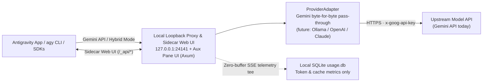

<p align="center">
  
</p>

<h1 align="center">Antigravity Companion</h1>

<p align="center">
  <strong>Bring your own models (BYOM) to Google Antigravity — use your own API keys alongside built-in models, preserve prompt caching, and track live token usage locally.</strong>
</p>

<p align="center">
  <a href="LICENSE"></a>
  
  <a href="Cargo.toml"></a>
  
  <a href="CONTRIBUTING.md"></a>
</p>

<p align="center">
  <a href="#why-agy-companion">Why</a> ·
  <a href="#quickstart">Quickstart</a> ·
  <a href="#how-it-works">How It Works</a> ·
  <a href="#built-for-trust">Trust &amp; Security</a> ·
  <a href="#roadmap--provider-adapters">Roadmap</a> ·
  <a href="#contributing">Contributing</a>
</p>

---

## Why `agy-companion`?

| Capability | What It Does for You |
| --- | --- |
| **Keep Your Built-In Models (Day-0 Safe)** | Leaves Antigravity's native model picker completely untouched until you save an API key. Once configured, your `(Proxy)` Gemini 3.8+ / 4+ models appear *alongside* your existing Google AI Pro, PayGo, or Enterprise models — never replacing them. |
| **Zero-Overhead Implicit Prompt Caching** | Forwards Gemini requests byte-for-byte with zero proxy re-serialization or HTTP compression tampering, preserving Gemini's implicit context caching while teeing token and cache metrics off the live SSE stream without buffering. |
| **Native Sidecar Web UI Inside Antigravity** | Manage write-only API keys, test connections, choose models, toggle Dock auto-start, and watch per-session live token and cache hit-rates directly in Antigravity's Aux Pane (`sidecar://agy-companion/proxy/`). |
| **Seamless Dock & Launcher Auto-Start** | Wakes an on-demand local daemon automatically when you launch Antigravity from the stock macOS Dock, Spotlight, Linux desktop launcher, or Windows Start Menu shortcut — with clean idle shutdown and isolated integrated terminals. Never patches `Antigravity.app` or `~/.gemini/config/config.json`. |
| **Single Local-Only Rust Binary** | Zero runtime dependencies (no Node or Python needed after install), `#![forbid(unsafe_code)]`, strictly bound to `127.0.0.1`, `0600` redacted key storage, and local WAL-mode SQLite `usage.db` recording token counts and latency only. |
| **Built for Multi-Provider BYOM** | Antigravity speaks one inbound wire protocol (Gemini API), so every new backend plugs in as a direct 1-hop Rust [`ProviderAdapter`](crates/companion-providers/src/lib.rs) — ready for Ollama Cloud, OpenAI-compatible endpoints, Codex, and Claude. |

---

## Quickstart

### Antigravity App (macOS, Linux & Windows)

```bash
# One-command install (Node >= 18)
npx -y agy-companion@latest install

# Or install globally via npm
npm i -g agy-companion && agy-companion install

# Or via Python / uvx (Python >= 3.9)
uvx --refresh agy-companion install
```

> **Pre-release status:** `v0.0.3` packaging is staged in-repo awaiting the first tagged release (`0.0.1` placeholder packages are currently reserved on npm and PyPI). To run `agy-companion` right now, use [Build from Source (Works Today)](#build-from-source-works-today) below.

**First run (3 steps):**

1. **Quit Antigravity completely** (`Cmd+Q` on macOS — closing the window is not enough) and reopen it normally from your Dock, Spotlight, or desktop launcher (on Windows, launch **Antigravity (Companion)** from the Start Menu).
2. Open **Antigravity Companion** via the side panel `+` menu (`aux_pane`), the left sidebar **Plugins** view (`global`), or by asking: *"Open the Antigravity Companion settings panel"*.
3. Paste your [Google AI Studio Gemini API key](https://aistudio.google.com/api-keys) (write-only, persisted atomically at `0600`) and click **Save**. The UI verifies the key automatically, and your `(Proxy)` Gemini 3.8+ / 4+ models appear alongside your native Antigravity models.

<details>
<summary>Upgrade, Uninstall, Full Purge, One-Shot Launch &amp; Alternative Modes</summary>

- **Upgrade:** Re-run `npx -y agy-companion@latest install` (or `npm i -g agy-companion@latest && agy-companion install`). Performs an atomic binary and plugin swap and safely replaces any version-skewed background proxy.
- **Uninstall (preserves `config.json`, `auth/`, and `usage/`):**
  ```bash
  npx -y agy-companion@latest uninstall
  # or, if already on $PATH:
  agy-companion uninstall
  ```
- **Full purge (also deletes `config.json`, `auth/`, `usage/`, `proxy.log`, and `sidecar_data/agy-companion`):**
  ```bash
  npx -y agy-companion@latest uninstall --purge
  ```
- **One-shot Hybrid Mode launch (no shell hook needed):**
  ```bash
  agy-companion launch
  ```
- **Manual plugin install via Antigravity CLI:**
  ```bash
  agy plugin install ./plugin && agy plugin list
  ```
- **Gateway Mode (all traffic via proxy, no Google OAuth):** Add `"gateway": {"url": "http://127.0.0.1:24141", "wireProtocol": "genai"}` to `~/.gemini/config/config.json` (`GET /v1beta/models` discovery).

See [`docs/design/dock-launcher-and-install.md`](docs/design/dock-launcher-and-install.md) and [`plugin/README.md`](plugin/README.md) for lifecycle details and troubleshooting.

</details>

### Antigravity CLI (`agy`) & Gemini SDKs

```bash
# Generate ready-to-paste customModelsConfig JSON for ~/.gemini/antigravity-cli/settings.json
agy-companion models --json

# Or route agy CLI / Gemini SDK traffic directly via env var
export GOOGLE_GEMINI_BASE_URL="http://127.0.0.1:24141"
agy --settings '{"modelProvider":"gemini"}' -p "Hello from Antigravity Companion"

# Verify proxy health, config permissions, version match, and env setup anytime
agy-companion doctor
```

> **Note:** When `modelProvider` is `"gemini"`, `agy` CLI checks that `GEMINI_API_KEY` is non-empty in your shell environment. Once an API key is saved in `agy-companion`'s config file, the proxy authenticates upstream requests using your saved key via `x-goog-api-key`.

<details>
<summary>Sample <code>agy-companion models --json</code> output</summary>

```json
{
  "modelProvider": "gemini",
  "customModelsConfig": {
    "customModels": [
      {
        "modelName": "gemini-api://http://127.0.0.1:24141/models/gemini-4-hydrogen",
        "label": "Antigravity Companion (gemini-4-hydrogen)"
      },
      {
        "modelName": "gemini-api://http://127.0.0.1:24141/models/gemini-4-carbon",
        "label": "Antigravity Companion (gemini-4-carbon)"
      },
      {
        "modelName": "gemini-api://http://127.0.0.1:24141/models/gemini-4-neon",
        "label": "Antigravity Companion (gemini-4-neon)"
      },
      {
        "modelName": "gemini-api://http://127.0.0.1:24141/models/gemini-4-argon",
        "label": "Antigravity Companion (gemini-4-argon)"
      },
      {
        "modelName": "gemini-api://http://127.0.0.1:24141/models/gemini-3.8-flash",
        "label": "Antigravity Companion (gemini-3.8-flash)"
      }
    ]
  }
}
```

</details>

### Build from Source (Works Today)

Requires Rust (`edition = "2024"`) and Node `>= 18` (for building the embedded UI bundle).

```bash
# Option A: Build UI + Rust debug binary and symlink ./plugin into ~/.gemini/config/plugins/agy-companion
./scripts/dev-install.sh

# Option B: Run the full installer directly from source (embeds the 6-file plugin + Dock/Launcher hook)
cargo run -p companion-cli -- install

# Option C: Run the standalone loopback proxy in the foreground
cargo run -p companion-cli -- serve
```

---

## How It Works



### Workspace Map

| Component | Path | Responsibility |
| --- | --- | --- |
| **Workspace Overview** | [`crates/README.md`](crates/README.md) | 5-crate Rust 2024 workspace (`#![forbid(unsafe_code)]`) compiling into a single native binary. |
| **Core Domain** | [`crates/companion-core`](crates/companion-core/README.md) | Nested v1 config, atomic/TOCTOU-safe file I/O, model catalog, secret redaction, SQLite WAL `UsageSink`, and shell hook integration. |
| **Provider Layer** | [`crates/companion-providers`](crates/companion-providers/README.md) | `ProviderAdapter` async trait, zero-compression `GeminiProvider`, and shared loopback probe client. |
| **Loopback Proxy** | [`crates/companion-proxy`](crates/companion-proxy/README.md) | `127.0.0.1` Axum HTTP proxy, Hybrid Mode catalog bridge, non-blocking config hot-reload, idle shutdown, and SSE usage tee. |
| **UI Backend** | [`crates/companion-ui`](crates/companion-ui/README.md) | Embedded UI asset loader and redacted settings, health, usage, and launcher integration service backing the Sidecar Web UI. |
| **Unified CLI** | [`crates/companion-cli`](crates/companion-cli/README.md) | Single `agy-companion` binary embedding the 6-file plugin bundle with `install`, `uninstall`, `serve` (proxy + Sidecar Web UI), `doctor`, `models`, `launch`, `hook-env`, and `integration`. |
| **Embedded UI** | [`ui/`](ui/) | Zero-runtime-dependency Vite + TypeScript single-file Sidecar Web UI frontend compiled into `ui/dist/index.html` and embedded at build time. |
| **Antigravity Plugin** | [`plugin/README.md`](plugin/README.md) | Plugin manifest, bundled SVG icon, Sidecar Web UI definition, hardened launcher script, and companion skill. |
| **Distribution Shims** | [`packages/`](packages/) | Cross-platform npm (`agy-companion` / `agyc` + 5 platform packages) and Python (`maturin`) binary wrappers. |
| **Opaque-Box E2E** | [`e2e/README.md`](e2e/README.md) | Pure Python 3 stdlib parallel intent-named opaque-box end-to-end test suite verifying binary CUJs, security boundaries, runtime shims, and headless Chrome UI smoke. |

---

## Built for Trust

Because `agy-companion` sits on your machine and handles model API keys, security is built into the core invariants rather than bolted on later:

- **Loopback-only (`127.0.0.1`):** Refuses `0.0.0.0`, `::`, and non-loopback hosts, re-verifies the bound socket address at startup, and exposes no `--host` CLI flag.
- **Write-only, redacted secrets:** API keys are written atomically outside workspaces (`0600` on Unix, user-profile ACLs on Windows), never returned in plaintext by UI APIs, and sent upstream strictly via `x-goog-api-key` headers (never `?key=` query strings).
- **Zero prompt or response logging:** Local SQLite `usage.db` (`0600`, WAL mode) records token counts, cache hits, and latency only — never prompt text, code, or API keys.
- **Memory-safe Rust + CSP-locked UI:** `#![forbid(unsafe_code)]` across every Rust crate, SSRF and HTTP redirect blocking (`Policy::none()`), upfront 64 MiB request bounds, and a zero-`innerHTML` Sidecar Web UI frontend authenticated with per-launch `X-Sidecar-Token`.
- **Non-invasive & cleanly reversible:** Never patches `Antigravity.app` or mutates `~/.gemini/config/config.json`; `uninstall` removes hooks, plugin files, and binary cleanly without touching unrelated processes or files.

See [`SECURITY.md`](SECURITY.md) for private vulnerability reporting and [`AGENTS.md`](AGENTS.md#architecture--security-invariants) for the full S1–S8 security enforcement contract.

<details>
<summary>Reference: CLI Subcommands, HTTP Endpoints &amp; Config / Data Paths</summary>

#### CLI Subcommands

| Command | Flags & Behavior |
| --- | --- |
| `agy-companion install` | `[--config <CONFIG>]` `[--plugins-dir <DIR>]` `[--no-launcher-hook]` `[--no-start-proxy]` `[--force]` `[--json]` — installs the embedded 6-file plugin, stages the native binary, configures Dock/Launcher hook (or Windows Start Menu `.lnk`), and starts/upgrades the local proxy. |
| `agy-companion uninstall` | `[--config <CONFIG>]` `[--plugins-dir <DIR>]` `[--purge]` `[--dry-run]` `[--json]` — removes shell hooks, plugin directory, and verified proxy daemon; preserves `config.json`, `auth/`, and `usage/` unless `--purge` is passed. |
| `agy-companion integration` | `enable\|disable\|status [--shell <zsh\|bash\|fish>] [--rc-file <PATH>] [--binary <PATH>] [--follow-rc-symlink] [--json]` — manages Dock/Launcher login-shell integration (`--binary` on `enable`; `--follow-rc-symlink` on `enable`/`disable`). |
| `agy-companion hook-env` | `[--ensure-running]` `[--print-port]` `[--port <PORT>]` `[--config <CONFIG>]` `[--plugins-dir <DIR>]` — fail-open login-shell helper that wakes the managed daemon and prints its validated port. |
| `agy-companion serve` | `[--port <PORT>]` (`1–65535`, default `24141`) `[--config <CONFIG>]` `[--adopt-running]` `[--auto-enable-launcher]` `[--idle-shutdown-secs <SECS>]` — runs the loopback proxy strictly on `127.0.0.1` (no `--host` flag) and optional Sidecar Web UI (`ANTIGRAVITY_SIDECAR_WEB_PORT`). |
| `agy-companion launch` | `[--port <PORT>]` `[--config <CONFIG>]` `[--app <PATH>]` `[--print-env]` — launches Antigravity App directly in Hybrid Mode for a single session. |
| `agy-companion doctor` | `[--config <CONFIG>]` `[--port <PORT>]` `[--json]` — verifies config permissions, schema, proxy `/health`, version match, and env setup. |
| `agy-companion models` | `[--json]` `[--port <PORT>]` `[--config <CONFIG>]` — prints `customModelsConfig` JSON for `agy` CLI. |
| `agy-companion --version` | Prints `agy-companion <version>`. |

#### Local HTTP Endpoints (`127.0.0.1:24141`)

| Method & Route | Behavior |
| --- | --- |
| `GET /health` | `200 OK` JSON `{status, version, protocol_version}` (`nosniff`, `no-store`). |
| `GET /api/stats` | `200 OK` JSON with live session request, token, implicit cache hit-ratio, process RAM RSS (`proxy_rss_bytes`), and Hybrid Mode catalog telemetry (`nosniff`, `no-store`). |
| `GET /v1beta/models` | Filtered Gemini 3.8+ & 4+ chat model catalog (`default_model` first) with curated fallback. |
| `POST /v1beta/models/{*rest}` | `:generateContent` and `:streamGenerateContent?alt=sse`; 64 MiB cap, byte-for-byte streaming pass-through, zero-buffer `usageMetadata` tee. |
| `POST /v1internal:fetchAvailableModels`<br>`GET/POST /v1internal:*` | Transparent Hybrid Mode bridge preserving native Antigravity models alongside configured `(Proxy)` models (Day-0 untouched until an API key is saved). Non-`GET`/`POST` methods return `405`. |

#### Configuration & Usage Data Paths (XDG + Windows)

| Resource | Precedence Order (Highest → Lowest) |
| --- | --- |
| **Config file** | `--config <path>` → `AGY_COMPANION_CONFIG` → `$XDG_CONFIG_HOME/agy-companion/config.json` → Platform default |
| **Auth credentials (`auth/gemini.json`)** | Sibling `auth/` directory next to the resolved `config.json` (`0700` dir / `0600` file on Unix) |
| **Data dir (`env.sh`, `proxy.pid`, `proxy.log`, `bin/`)** | `$XDG_DATA_HOME/agy-companion` → Platform default |
| **Usage dir (`usage.db`)** | `config.usage_dir` → `$XDG_DATA_HOME/agy-companion/usage` → Platform default |

| Platform | Default Config & Auth Files | Default Data / Usage Directory |
| --- | --- | --- |
| **macOS & Linux** | `~/.config/agy-companion/config.json` + `auth/gemini.json` *(no `~/Library/Application Support/` drift)* | `~/.local/share/agy-companion` (`usage/`, `env.sh`, `proxy.pid`, `proxy.log`, `bin/`) |
| **Windows** | `%APPDATA%\agy-companion\config.json` + `auth\gemini.json` *(fallback: `%USERPROFILE%\.config\agy-companion\...`)* | `%LOCALAPPDATA%\agy-companion` (`usage/`, `proxy.pid`, `proxy.log`, `bin/`; fallback: `%USERPROFILE%\.local\share\agy-companion`) |

`XDG_CONFIG_HOME` and `XDG_DATA_HOME` apply only when set, non-empty, and absolute; `..` traversal, NUL bytes, symlinks, and non-regular files are rejected fail-closed.

Full architecture & security enforcement details: [`docs/design/architecture.md`](docs/design/architecture.md) · [`AGENTS.md`](AGENTS.md#architecture--security-invariants) · [`SECURITY.md`](SECURITY.md).

</details>

---

## Roadmap & Provider Adapters

| Milestone | Scope | Status |
| --- | --- | --- |
| **Core Gemini BYOM (`v0.0.2`)** | Loopback Rust proxy with implicit cache preservation, Day-0 safe Hybrid Mode, Dock/Launcher auto-start, one-command `install`/`uninstall`, native Sidecar Web UI, SQLite WAL `usage.db` capture, cross-platform npm/PyPI shims | Shipped |
| **UX v2 & Usage Dashboard** | Multi-select enabled models with tooltips, dedicated **Usage** historical analytics & cost tab backed by `usage.db`, modular multi-provider Settings UI | Shipped ([design spec](docs/design/ui-ux-v2.md)) |
| **Ollama Cloud & OpenAI-Compatible Adapter** | Direct 1-hop `Gemini ↔ OpenAI Chat Completions` adapter unlocking Ollama Cloud, local Ollama, OpenRouter, vLLM, LM Studio, and OpenAI API | Planned — **Contributors Welcome** |
| **Codex & Claude Adapters** | First-class provider adapters for OpenAI Codex and Anthropic Claude | Planned — **Contributors Welcome** |
| **Usage CLI & Upgrade Lifecycle** | `agy-companion usage` terminal rollups and `agy-companion upgrade` lifecycle | Planned ([usage](docs/design/usage-tracking-todo.md), [upgrade](docs/design/upgrade-lifecycle-todo.md)) |

Adding a new model provider does not require touching the proxy core or Antigravity plugin plumbing — every backend implements the 4-method `ProviderAdapter` trait in [`crates/companion-providers/src/lib.rs`](crates/companion-providers/src/lib.rs):

```rust
pub trait ProviderAdapter: Send + Sync {
    fn name(&self) -> &'static str;

    fn forward_gemini(
        &self,
        req: ForwardRequest,
    ) -> BoxFuture<'_, Result<ForwardResponse, ProviderError>>;

    fn health_check(&self) -> BoxFuture<'_, Result<(), ProviderError>>;

    fn list_models(
        &self,
        _api_key_override: Option<String>,
    ) -> BoxFuture<'_, Result<GeminiModelList, ProviderError>> {
        Box::pin(async {
            Err(ProviderError::Upstream(
                "upstream model discovery not implemented".to_string(),
            ))
        })
    }
}
```

Want to bring your favorite provider to Google Antigravity? Open a [Provider Adapter proposal](https://github.com/Jacksunwei/agy-companion/issues/new?template=provider_adapter.yml) or read [`CONTRIBUTING.md`](CONTRIBUTING.md) to get started.

---

## Contributing

Contributions are welcome — especially new `ProviderAdapter` backends, UX improvements, and platform polish. The local build and verification loop runs completely offline in three commands:

```bash
# 1. Build UI + Rust debug binary and link ./plugin for local Antigravity testing
./scripts/dev-install.sh

# 2. Run the full 7-gate local verification script (fmt, clippy -D warnings, tests, UI CSP, plugin validation)
./scripts/agent_check.sh

# 3. Run the pure Python 3 stdlib parallel opaque-box E2E suite (-B avoids __pycache__)
cargo build -p companion-cli
python3 -B e2e/run_e2e.py --suite all --workers 4 --binary target/debug/agy-companion --repo-root . -v
```

- **Contributor Guide:** [`CONTRIBUTING.md`](CONTRIBUTING.md) — prerequisites, adding a `ProviderAdapter`, UI hot-reload, commit conventions.
- **Local Dev Runbook:** [`.agents/skills/local-dev/SKILL.md`](.agents/skills/local-dev/SKILL.md) — zero-rebuild UI iteration via `AGY_COMPANION_UI_HTML`, live sidecar reload, log inspection.
- **Coding Agents:** [`AGENTS.md`](AGENTS.md) — canonical repo contract, verification gates, and S1–S8 invariants.
- **Security Policy:** [`SECURITY.md`](SECURITY.md) — private vulnerability reporting and security scope.

---

## Documentation & License

- **Design Specs:** [`docs/README.md`](docs/README.md) · [`docs/design/architecture.md`](docs/design/architecture.md) · [`docs/design/ui-ux-v2.md`](docs/design/ui-ux-v2.md) · [`docs/design/dock-launcher-and-install.md`](docs/design/dock-launcher-and-install.md)
- **Component Guides:** [`crates/README.md`](crates/README.md) · [`plugin/README.md`](plugin/README.md) · [`e2e/README.md`](e2e/README.md)
- **License:** Licensed under the [Apache License 2.0](LICENSE).
