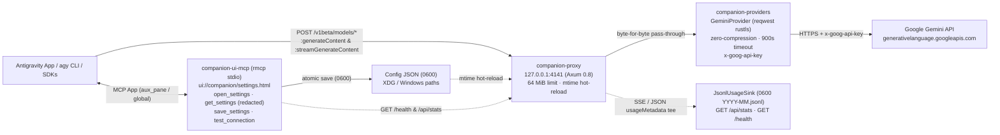

# Antigravity Companion (`agy-companion`)

Bring your own models (BYOM) and track token usage and implicit cache hit rates in Google Antigravity (`agy`) via a single zero-prerequisite native Rust binary powering both a loopback Gemini API pass-through proxy sidecar (`127.0.0.1:4141`) and an embedded MCP App Settings UI (`ui://companion/settings.html`).

- **Version:** `0.1.0` | **License:** [Apache-2.0](LICENSE) | **Toolchain:** Rust `edition = "2024"` (`#![forbid(unsafe_code)]`)
- **Repository:** <https://github.com/Jacksunwei/agy-companion>

## Architecture



### Workspace & Components

| Component | Path | Responsibility |
| --- | --- | --- |
| **Core Domain** | [`crates/companion-core/`](crates/companion-core/) | Versioned config (`schema_version = 1`), XDG + Windows path precedence, atomic `0600` persistence, `RedactedConfig` masking, `GeminiUsageMetadata`, `UsageSink` / `JsonlUsageSink` |
| **Provider Layer** | [`crates/companion-providers/`](crates/companion-providers/) | `ProviderAdapter` async trait + raw `reqwest 0.13` (`rustls`, zero compression) `GeminiProvider` pass-through & `health_check()` |
| **Loopback Proxy** | [`crates/companion-proxy/`](crates/companion-proxy/) | Strict `127.0.0.1` Axum 0.8 proxy, `GET /health`, `GET /api/stats`, `POST /v1beta/models/{*rest}` (64 MiB cap), SSE/JSON `usageMetadata` tee, config mtime hot-reload |
| **MCP App Server** | [`crates/companion-ui-mcp/`](crates/companion-ui-mcp/) | `rmcp 3.11` stdio MCP server serving embedded `ui://companion/settings.html` + `open_settings`, redacted `get_settings`, serialized `save_settings`, `test_connection` |
| **Unified CLI** | [`crates/companion-cli/`](crates/companion-cli/) | Single `agy-companion` binary (`serve`, `ui-mcp`, `doctor`, `models`, `--version`) with `rmcp` `INFO` log ceiling |
| **Embedded UI** | [`ui/`](ui/) | Vite 8 + TypeScript + `@modelcontextprotocol/ext-apps 2` single-file bundle ([`ui/dist/index.html`](ui/dist/index.html), `266,068` bytes `< 512,000`, zero `innerHTML`) |
| **Antigravity Plugin** | [`plugin/`](plugin/) | Plugin manifest, bundled SVG icon ([`assets/logo.svg`](plugin/assets/logo.svg)), MCP & proxy sidecar definitions, SHA-256-verifying launcher [`run-companion.sh`](plugin/scripts/run-companion.sh), companion skill |
| **Distribution Shims** | [`packages/`](packages/) | npm (`agy-companion` / `agyc` + 5 `@agy-companion/<os>-<arch>` optionalDeps) and Python (`maturin` `bindings = "bin"`) |
| **Opaque-Box E2E** | [`e2e/`](e2e/) | Pure Python 3 stdlib 4-tier E2E test suite (`199` E2E tests + `21` harness self-tests; see [`e2e/README.md`](e2e/README.md)) |

---

## Quickstarts

### 1. Antigravity App Plugin

Build from a local checkout and symlink `./plugin` into `~/.gemini/config/plugins/agy-companion` (never mutates Antigravity user settings):

```bash
./scripts/dev-install.sh
```

Or install the plugin bundle directly with the Antigravity CLI:

```bash
agy plugin install ./plugin
agy plugin list
```

Then configure your Gemini API key in Antigravity App:

1. Open **Antigravity Companion** via the side panel `+` menu (`aux_pane`), the left sidebar **Plugins** view (`global`), or by prompting: *"Open the Antigravity Companion settings panel"*.
2. Paste your Gemini API key (write-only; persisted atomically at Unix mode `0600` and never returned in plaintext), then click **Save Settings** and **Test Connection**.
3. *(Optional — Antigravity App Gateway Mode)* To populate Antigravity App's model picker directly from `agy-companion` (`GET /v1beta/models`), add the `"gateway"` block to `~/.gemini/config/config.json` and restart Antigravity App:

```json
{
  "gateway": {
    "url": "http://127.0.0.1:4141",
    "wireProtocol": "genai"
  }
}
```

> **Note:** Gateway Mode works with personal Antigravity App (no Gemini Enterprise/MDM required), and replaces Google OAuth / AI Pro models while enabled — all model requests route through `agy-companion`. Remove `"gateway"` and restart to switch back.

See [`plugin/README.md`](plugin/README.md) and [`plugin/skills/companion/SKILL.md`](plugin/skills/companion/SKILL.md) for full plugin usage and troubleshooting.

### 2. `agy` CLI Integration

Generate a ready-to-paste `customModelsConfig` block for `~/.gemini/antigravity-cli/settings.json`:

```bash
agy-companion models --json
```

```json
{
  "modelProvider": "gemini",
  "customModelsConfig": {
    "customModels": [
      {
        "modelName": "gemini-api://http://127.0.0.1:4141/models/gemini-4-hydrogen",
        "label": "Antigravity Companion (gemini-4-hydrogen)"
      },
      {
        "modelName": "gemini-api://http://127.0.0.1:4141/models/gemini-4-argon",
        "label": "Antigravity Companion (gemini-4-argon)"
      },
      {
        "modelName": "gemini-api://http://127.0.0.1:4141/models/gemini-4-neon",
        "label": "Antigravity Companion (gemini-4-neon)"
      },
      {
        "modelName": "gemini-api://http://127.0.0.1:4141/models/gemini-4-carbon",
        "label": "Antigravity Companion (gemini-4-carbon)"
      },
      {
        "modelName": "gemini-api://http://127.0.0.1:4141/models/gemini-3.8-flash",
        "label": "Antigravity Companion (gemini-3.8-flash)"
      }
    ]
  }
}
```

Or route `agy` CLI / Gemini SDK traffic via environment variables and inline settings:

```bash
export GOOGLE_GEMINI_BASE_URL="http://127.0.0.1:4141"
agy --settings '{"modelProvider":"gemini"}' -p "Hello from Antigravity Companion"
```

> **Note:** When `modelProvider` is `"gemini"`, `agy` CLI checks that `GEMINI_API_KEY` is non-empty in your shell environment. When an API key is already saved in `agy-companion`'s config file, the proxy authenticates upstream requests with your saved config key via `x-goog-api-key`.

Verify proxy health, config permissions, version match, and env setup at any time:

```bash
agy-companion doctor          # human-readable diagnostics (exits non-zero on critical errors/skew)
agy-companion doctor --json   # machine-readable JSON output
```

### 3. Cross-Platform Shims & Source Build

| Method | Requirements | Commands |
| --- | --- | --- |
| **npm (`npx`)** | Node `>= 18` (5 `@agy-companion/<os>-<arch>` optionalDeps: `darwin-arm64`, `darwin-x64`, `linux-x64`, `linux-arm64`, `win32-x64`; exposes `agy-companion` & `agyc`) | `npx agy-companion --version`<br>`npx agy-companion serve`<br>`npx agy-companion doctor` |
| **Python (`uvx`)** | Python `>= 3.9` (`maturin` `bindings = "bin"` native binary wheel) | `uvx agy-companion --version`<br>`uvx agy-companion serve` |
| **Rust Source** | Rust toolchain (`edition = "2024"`) | `cargo build -p companion-cli`<br>`cargo run -p companion-cli -- serve` |

> **Release Status:** `agy-companion@0.0.1` (and the `@agy-companion` npm org scope) are reserved as placeholders on npm and PyPI; `0.1.0` is packaged in [`packages/npm/agy-companion/package.json`](packages/npm/agy-companion/package.json) and [`packages/python/pyproject.toml`](packages/python/pyproject.toml) for the first tagged release. Building from source (`./scripts/dev-install.sh` or `cargo run -p companion-cli -- ...`) works immediately.

### CLI Commands & HTTP Endpoints

| Surface | Invocation / Route | Flags / Behavior |
| --- | --- | --- |
| **Proxy Server** | `agy-companion serve` | `[--port <PORT>]` (`1–65535`, default `4141`), `[--config <CONFIG>]`; binds strictly to `127.0.0.1`, no `--host` flag |
| **MCP App Server** | `agy-companion ui-mcp` | `[--data-dir <DATA_DIR>]`, `[--config <CONFIG>]`; `stdout` strictly JSON-RPC, logs strictly `stderr` |
| **Diagnostics** | `agy-companion doctor` | `[--config <CONFIG>]`, `[--port <PORT>]`, `[--json]`; checks config perms, schema, `/health`, version skew, env vars |
| **Model Config** | `agy-companion models` | `[--json]`, `[--port <PORT>]`, `[--config <CONFIG>]`; emits `customModelsConfig` JSON for `agy` CLI |
| **Version** | `agy-companion --version` | Prints `agy-companion 0.1.0` |
| **Health Probe** | `GET /health` | `200 OK` JSON `{status, version, protocol_version: 1}` (`nosniff`, `no-store`) |
| **Telemetry Stats** | `GET /api/stats` | `200 OK` JSON `{requests, prompt_tokens, cached_tokens, output_tokens, reasoning_tokens, cache_hit_ratio}` (`nosniff`, `no-store`) |
| **Gemini Proxy** | `POST /v1beta/models/{*rest}` | `:generateContent` & `:streamGenerateContent?alt=sse`; 64 MiB cap, byte-for-byte streaming pass-through, `usageMetadata` tee |

---

## Configuration & Usage Data Paths (XDG + Windows)

### Resolution Precedence

| Resource | Precedence Order (Highest → Lowest) |
| --- | --- |
| **Config file** | `--config <path>` → `AGY_COMPANION_CONFIG` → `$XDG_CONFIG_HOME/agy-companion/config.json` → Platform default |
| **Usage JSONL dir** | `config.usage_dir` → `$XDG_DATA_HOME/agy-companion/usage` → Platform default (writes `YYYY-MM.jsonl`) |

### Platform Defaults

| Platform | Default Config File | Default Usage Directory |
| --- | --- | --- |
| **macOS & Linux** | `~/.config/agy-companion/config.json` *(no `~/Library/Application Support/` drift on macOS)* | `~/.local/share/agy-companion/usage` |
| **Windows** | `%APPDATA%\agy-companion\config.json` *(fallback: `%USERPROFILE%\.config\agy-companion\config.json`)* | `%LOCALAPPDATA%\agy-companion\usage` *(fallback: `%USERPROFILE%\.local\share\agy-companion\usage`)* |

- **XDG rules:** `XDG_CONFIG_HOME` and `XDG_DATA_HOME` apply only when set, non-empty, and platform-absolute. Unset, blank, or benign relative values fall back to the platform default; `..` traversal, NUL bytes, symlinks, and FIFOs/non-regular files are rejected fail-closed.
- **Atomic persistence:** `Config::save_secure` writes to a sibling temp file + `sync_all()` + `fs::rename` (Unix parent `0700` / file `0600`; Windows user-profile ACLs with a bounded 3-attempt `25ms` → `50ms` retry on transient `PermissionDenied`).

---

## Local Development & Verification

See [`.agents/skills/local-dev/SKILL.md`](.agents/skills/local-dev/SKILL.md), [`e2e/README.md`](e2e/README.md), and [`AGENTS.md`](AGENTS.md) for the complete contributor workflow.

```bash
# 1. Build UI + Rust debug binary and symlink ./plugin into ~/.gemini/config/plugins/agy-companion
#    Flags: --no-build | --release | --dry-run | --uninstall | --plugins-dir <dir> | -h/--help
./scripts/dev-install.sh

# 2. Instant UI iteration (zero Rust rebuild — close & reopen Antigravity Companion aux pane)
export AGY_COMPANION_UI_HTML="$(pwd)/ui/dist/index.html"
npm --prefix ui run build

# 3. Live MCP server reload in Antigravity App (no App restart):
#    Settings > MCP Servers > agy-companion_companion > Restart
#    or RefreshMcpServers RPC with {"serverName": "agy-companion_companion"}

# 4. Inspect sidecar logs:
ls -la ~/.gemini/antigravity/sidecar_data/agy-companion/proxy/logs/

# 5. Full 7-gate local verification & Rust workspace tests (132 tests)
./scripts/agent_check.sh
cargo test --workspace

# 6. Pure Python 3 stdlib opaque-box E2E suite (21 self-tests + 199 E2E tests: T1=82, T2=94, T3=16, T4=7)
python3 -B e2e/run_e2e.py --self-test -v
python3 -B e2e/run_e2e.py --tier all --binary target/debug/agy-companion --repo-root . -v
```

---

## Security & Hardening Invariants (S1–S8)

All 5 Rust crates, `crates/companion-cli/src/main.rs`, and CLI integration tests enforce `#![forbid(unsafe_code)]`.

| ID | Invariant | Enforced Controls (incl. M8 Tier-5 Hardening) |
| --- | --- | --- |
| **S1** | **Loopback-only proxy** | `validate_listen_host` allows only `127.0.0.1` / `localhost`, listener binds `Ipv4Addr::LOCALHOST` and re-verifies `local_addr()`, and CLI exposes no `--host` flag. |
| **S2** | **Secret redaction, atomic writes & zero leaks** | `get_settings`/`open_settings` return `RedactedConfig` only (`AIza...abcd` / `****`, never plaintext); `Config::validate()` enforces printable-ASCII `api_key` header safety; `config_write_lock` serializes concurrent `save_settings`; `Config::save_secure` uses atomic temp+`sync_all()`+rename (`0600`/`0700` Unix, 3-attempt `25ms`→`50ms` retry Windows); `JsonlUsageSink` & `run_serve` reject symlink/FIFO targets and verify post-open `is_file()` + `(dev, ino)` before `chmod 0600` or write; `rmcp` tracing is capped at `INFO`; `agent_check.sh` scans for `AIza[0-9A-Za-z_-]{35}`. |
| **S3** | **Upstream auth & SSRF defense** | Authenticates upstream via `x-goog-api-key` (strips `?key=`, preserves `?alt=sse`); remote `base_url` requires `https://` (`http://` restricted to literal `127.0.0.1` / `localhost`); rejects credentials, backslashes, `..` traversal, and HTTP redirects (`Policy::none()`). |
| **S4** | **Raw pass-through & zero compression** | `reqwest 0.13` enables only `rustls`, `stream`, `json`, `http2` (zero `gzip`/`brotli`/`deflate`/`zstd`); request bytes forward untouched (preserving implicit caching, 900s timeout) and SSE/JSON streams tee `usageMetadata` without mutating or buffering payloads. |
| **S5** | **UI zero-`innerHTML` & strict CSP** | Safe DOM APIs only (`createElement`, `textContent`, `replaceChildren`); handlers registered before `app.connect()`; `snapshotEpoch` stale-refresh guard & `refreshBtn` write lockout; unified S5 sink & whitespace-aware external-tag scanning across `ui/src/` and `ui/dist/index.html` (`< 512,000` bytes); `AGY_COMPANION_UI_HTML` checks `fs::metadata` (`is_file()` & `MAX_UI_HTML_BYTES = 10 MiB`) before `File::open()`. |
| **S6** | **Path validation & fail-closed config loading** | XDG + Windows precedence with fail-closed `..`/NUL rejection; `MAX_CONFIG_FILE_BYTES` (`1 MiB`) cap; symlink/FIFO/non-regular rejection + post-open `fstat` `is_file()` & `(dev, ino)` checks across `Config::load_or_default`, `doctor`, and proxy startup/hot-reload (`FileStamp::Rejected` retains previous active config). |
| **S7** | **Minimal HTTP surface & upfront limits** | Only `GET` and `POST` allowed (`405` otherwise); outermost `enforce_content_length_limit` rejects malformed/conflicting `Content-Length` (`400`) and `> 64 MiB` / overflow (`413`) before reading body bytes alongside `DefaultBodyLimit::max(64 MiB)`; `X-Content-Type-Options: nosniff` + `Cache-Control: no-store` on `/health`, `/api/stats`, and JSON errors. |
| **S8** | **Launcher integrity & packaging allow-list** | `run-companion.sh` uses physical `cd -P --`, HTTPS-only downloads, SHA-256 verification (`< "${checksums_file}"` redirection), `tar -f -` stdin traversal checks, and `INT`/`TERM`/`HUP`/`EXIT` traps; `dev-install.sh` uses `cd -P --` symlink safety; npm shim uses `execFileSync` with a hardcoded 5-target allow-list and public `publishConfig`; Python `find_binary()` rejects `..`/NUL; 4-way version parity (`0.1.0`). |

---

## Roadmap

- **Milestone 1 (Complete — `v0.1.0`):** Loopback Gemini pass-through proxy with implicit cache preservation, embedded MCP App Settings UI (`aux_pane` + `global`), unified CLI (`serve`/`ui-mcp`/`doctor`/`models`), Antigravity plugin bundle, npm/PyPI distribution shims, XDG + Windows path support, day-1 `UsageSink` & version/skew seams, `132` Rust tests, `199` opaque-box E2E tests (+ `21` self-tests), and M8 Tier-5 adversarial hardening.
- **M2 & M3 (Planned):** Codex Pro and Claude provider adapters behind the `ProviderAdapter` trait ([`crates/companion-providers/`](crates/companion-providers/)).
- **M4 (Planned):** Ollama Cloud and OpenAI-compatible 1-hop `Gemini ↔ OpenAI Chat Completions` adapter (local Ollama, OpenRouter, vLLM, LM Studio, OpenAI API).
- **Deferred Day-1 Seams:**
  - **Usage & Cost Reporting:** [`docs/design/usage-tracking-todo.md`](docs/design/usage-tracking-todo.md) (`agy-companion usage` CLI rollups, pricing table, MCP App Usage & Cost tab).
  - **Version Upgrades & Lifecycle:** [`docs/design/upgrade-lifecycle-todo.md`](docs/design/upgrade-lifecycle-todo.md) (`agy-companion upgrade`, lockstep plugin/binary refresh, opt-out update notifications, `schema_version` migrations).

## Documentation & License

- **Docs:** [`docs/README.md`](docs/README.md) · [`docs/design/architecture.md`](docs/design/architecture.md) · [`docs/design/m1-implementation-plan.md`](docs/design/m1-implementation-plan.md) · [`plugin/README.md`](plugin/README.md) · [`e2e/README.md`](e2e/README.md) · [`AGENTS.md`](AGENTS.md)
- **License:** Licensed under the [Apache License 2.0](LICENSE).
