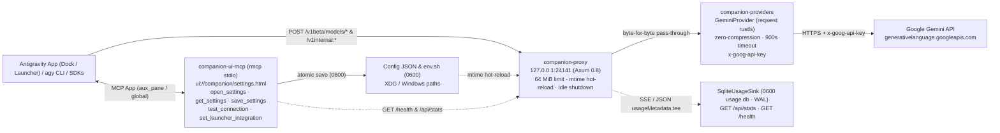

# Antigravity Companion (`agy-companion`)

Bring your own models (BYOM) and track token usage and implicit cache hit rates in Google Antigravity (`agy`) via a single native Rust binary powering a loopback Gemini pass-through proxy (`127.0.0.1:24141`), native Dock/Launcher auto-start, and an embedded MCP App Settings UI (`ui://companion/settings.html`).

- **Version:** `0.1.0` | **License:** [Apache-2.0](LICENSE) | **Toolchain:** Rust `edition = "2024"` (`#![forbid(unsafe_code)]`)
- **Repository:** <https://github.com/Jacksunwei/agy-companion>

## Architecture



### Workspace & Components

| Component | Path | Responsibility |
| --- | --- | --- |
| **Core Domain** | [`crates/companion-core/`](crates/companion-core/) | Nested v1 config (`schema_version = 1`), `fs_safe` TOCTOU/atomic `0600` guards, `protocol` wire DTOs, `validation`, unified Gemini 3.8+/4+ `models` catalog, nested `RedactedConfig` masking, `PROXY_PLACEHOLDER_API_KEY` quarantine, `UsageSink` + optional `sqlite` feature (`SqliteUsageSink`, WAL `usage.db`), zero-`eval` `integration` (`env.sh` + shell RC hooks, canonical `state` enum) |
| **Provider Layer** | [`crates/companion-providers/`](crates/companion-providers/) | `ProviderAdapter` async trait + raw `reqwest 0.13` (`rustls`, zero compression) `GeminiProvider` pass-through & `health_check()` |
| **Loopback Proxy** | [`crates/companion-proxy/`](crates/companion-proxy/) | Strict `127.0.0.1` Axum 0.8 proxy, `GET /health`, `GET /api/stats` (incl. CloudCode & catalog telemetry), `POST /v1beta/models/{*rest}` (64 MiB cap), CloudCode 8-entry 128-bit SipHash per-account LRU & Day-0 untouched catalog, SSE/JSON `usageMetadata` tee, config mtime hot-reload, active in-flight `IdleTracker` |
| **MCP App Server** | [`crates/companion-ui-mcp/`](crates/companion-ui-mcp/) | `rmcp 3.11` stdio MCP server serving embedded `ui://companion/settings.html` + 5 tools (`open_settings`, redacted `get_settings`, serialized `save_settings`, `test_connection`, `set_launcher_integration`) |
| **Unified CLI** | [`crates/companion-cli/`](crates/companion-cli/) | Single `agy-companion` binary (`install`, `uninstall`, `integration`, `hook-env`, `serve`, `launch`, `ui-mcp`, `doctor`, `models`, `--version`) with embedded 7-file plugin bundle and `rmcp` `INFO` log ceiling |
| **Embedded UI** | [`ui/`](ui/) | Vite 8 + TypeScript + `@modelcontextprotocol/ext-apps 2` single-file bundle ([`ui/dist/index.html`](ui/dist/index.html), `302,701` bytes `< 512,000`, zero `innerHTML`) |
| **Antigravity Plugin** | [`plugin/`](plugin/) | Plugin manifest, bundled SVG icon ([`assets/logo.svg`](plugin/assets/logo.svg)), MCP & proxy sidecar definitions, hardened launcher [`run-companion.sh`](plugin/scripts/run-companion.sh), companion skill |
| **Distribution Shims** | [`packages/`](packages/) | npm (`agy-companion` / `agyc` + 5 `@agy-companion/<os>-<arch>` optionalDeps) and Python (`maturin` `bindings = "bin"`) |
| **Opaque-Box E2E** | [`e2e/`](e2e/) | Pure Python 3 stdlib 4-tier E2E test suite (`333` E2E tests: `T1=140, T2=149, T3=31, T4=13` + `26` harness self-tests; see [`e2e/README.md`](e2e/README.md)) |

---

## Quickstarts

### 1. One-Command Install, Upgrade & Uninstall (macOS, Linux & Windows)

Install the embedded 7-file Antigravity plugin, stable native binary, Dock/Launcher auto-start hook (or Windows Start Menu shortcut), and background local proxy in one command:

```bash
# Hero one-command install (macOS, Linux & Windows; Node >= 18)
npx -y agy-companion@latest install

# Global npm alternative
npm i -g agy-companion && agy-companion install

# Python / uvx alternative
uvx --refresh agy-companion install
```

- **Upgrade:** Re-run `npx -y agy-companion@latest install` (or `npm i -g agy-companion@latest && agy-companion install`). Performs an atomic binary & 2-step plugin swap and safely replaces any version-skewed background proxy.
- **Uninstall (preserves `config.json` & `usage/`):**
  ```bash
  npx -y agy-companion@latest uninstall
  # or, if on $PATH:
  agy-companion uninstall
  ```
- **Full purge (also removes `config.json`, `usage/`, `proxy.log`, and `sidecar_data/agy-companion`):**
  ```bash
  npx -y agy-companion@latest uninstall --purge
  ```
  *(Never modifies `~/.gemini/config/config.json` or `/Applications/Antigravity.app`.)*

**After installing:**
1. **Quit Antigravity completely** (`Cmd+Q` on macOS — closing the window is not enough) and reopen it from Dock, Spotlight, or your desktop launcher (on Windows, launch **Antigravity (Companion)** from the Start Menu).
   - **macOS & Linux:** `install` writes an owned `0600` zero-`eval` `env.sh` + 1-line login-shell hook (`~/.zlogin`, `~/.profile` / existing Bash login profile, or `fish/conf.d/agy-companion.fish`) so clicking the stock Dock/Launcher icon starts the Managed On-Demand Daemon automatically while keeping MCP servers (`JETSKI_MCP_ENV_RESTORE_*`) and integrated terminals clean.
   - **Windows:** `install` writes direct-`.exe` plugin manifests (zero `bash` dependency) and creates a reversible Start Menu shortcut (`Antigravity (Companion).lnk`) without touching `HKCU\Environment` or running `setx`.
2. Open **Antigravity Companion** via the side panel `+` menu (`aux_pane`), the left sidebar **Plugins** view (`global`), or by prompting: *"Open the Antigravity Companion settings panel"*.
3. Paste your Gemini API key (write-only; persisted atomically at Unix mode `0600` and never returned in plaintext) and click **Save Settings**. The UI automatically verifies the key and shows a live 5-minute model-refresh countdown (or quit with `Cmd+Q` and reopen Antigravity to load `(Proxy)` models immediately).

> **Day-0 & Google AI Pro CloudCode Transparency:** Before a real API key is saved, `agy-companion` returns Antigravity's native `fetchAvailableModels` catalog completely untouched (zero `(Proxy)` models; `"agy-companion-local"` is quarantined so it never leaks upstream). Once a key is saved, `cloudcode.upstream = "auto"` preserves all original Google AI Pro (`daily-cloudcode-pa.googleapis.com`), PayGo, and Enterprise (`cloudcode-pa.googleapis.com`) models alongside `(Proxy)` Gemini 3.8+ / 4+ models with native secondary **Thinking effort** menus (`Low` / `Medium` / `High` / `XHigh`).

**Manual / Source Checkout Alternatives:**

```bash
# Build from local source checkout and symlink ./plugin (never mutates Antigravity settings)
./scripts/dev-install.sh

# Or install plugin directly via Antigravity CLI
agy plugin install ./plugin && agy plugin list

# Or launch Antigravity App directly in Hybrid Mode for one session
agy-companion launch
```

*(Alternative — Gateway Mode)* If you prefer routing all Antigravity App calls exclusively through the proxy without Google OAuth, add `"gateway": {"url": "http://127.0.0.1:24141", "wireProtocol": "genai"}` to `~/.gemini/config/config.json` (`GET /v1beta/models` discovery).

See [`docs/design/dock-launcher-and-install.md`](docs/design/dock-launcher-and-install.md), [`plugin/README.md`](plugin/README.md), and [`plugin/skills/companion/SKILL.md`](plugin/skills/companion/SKILL.md) for full architecture, plugin usage, and troubleshooting.

### 2. `agy` CLI Integration

Generate a ready-to-paste `customModelsConfig` block for `~/.gemini/antigravity-cli/settings.json`:

```bash
agy-companion models --json
```

```json
{
  "modelProvider": "gemini",
  "customModelsConfig": {
    "customModels": [
      {
        "modelName": "gemini-api://http://127.0.0.1:24141/models/gemini-4-hydrogen",
        "label": "Antigravity Companion (gemini-4-hydrogen)"
      },
      {
        "modelName": "gemini-api://http://127.0.0.1:24141/models/gemini-4-argon",
        "label": "Antigravity Companion (gemini-4-argon)"
      },
      {
        "modelName": "gemini-api://http://127.0.0.1:24141/models/gemini-4-neon",
        "label": "Antigravity Companion (gemini-4-neon)"
      },
      {
        "modelName": "gemini-api://http://127.0.0.1:24141/models/gemini-4-carbon",
        "label": "Antigravity Companion (gemini-4-carbon)"
      },
      {
        "modelName": "gemini-api://http://127.0.0.1:24141/models/gemini-3.8-flash",
        "label": "Antigravity Companion (gemini-3.8-flash)"
      }
    ]
  }
}
```

Or route `agy` CLI / Gemini SDK traffic via environment variables and inline settings:

```bash
export GOOGLE_GEMINI_BASE_URL="http://127.0.0.1:24141"
agy --settings '{"modelProvider":"gemini"}' -p "Hello from Antigravity Companion"
```

> **Note:** When `modelProvider` is `"gemini"`, `agy` CLI checks that `GEMINI_API_KEY` is non-empty in your shell environment. When an API key is already saved in `agy-companion`'s config file, the proxy authenticates upstream requests with your saved config key via `x-goog-api-key`.

Verify proxy health, config permissions, version match, and env setup at any time:

```bash
agy-companion doctor          # human-readable diagnostics (exits non-zero on critical errors/skew)
agy-companion doctor --json   # machine-readable JSON output
```

### 3. Cross-Platform Shims & Source Build

| Method | Requirements | Commands |
| --- | --- | --- |
| **npm (`npx` / `npm`)** | Node `>= 18` (5 `@agy-companion/<os>-<arch>` optionalDeps: `darwin-arm64`, `darwin-x64`, `linux-x64`, `linux-arm64`, `win32-x64`; exposes `agy-companion` & `agyc`) | `npx -y agy-companion@latest install`<br>`npm i -g agy-companion && agy-companion install`<br>`npx -y agy-companion@latest uninstall [--purge]` |
| **Python (`uvx`)** | Python `>= 3.9` (`maturin` `bindings = "bin"` native binary wheel) | `uvx --refresh agy-companion install`<br>`uvx --refresh agy-companion uninstall [--purge]` |
| **Rust Source** | Rust toolchain (`edition = "2024"`) | `cargo build -p companion-cli`<br>`cargo run -p companion-cli -- serve` |

> **Release Status:** `agy-companion@0.0.1` (and the `@agy-companion` npm org scope) are reserved as placeholders on npm and PyPI; `0.1.0` is packaged in [`packages/npm/agy-companion/package.json`](packages/npm/agy-companion/package.json) and [`packages/python/pyproject.toml`](packages/python/pyproject.toml) for the first tagged release. Building from source (`./scripts/dev-install.sh` or `cargo run -p companion-cli -- ...`) works immediately.

### CLI Commands & HTTP Endpoints

| Surface | Invocation / Route | Flags / Behavior |
| --- | --- | --- |
| **Installer** | `agy-companion install` | `[--plugins-dir <DIR>]`, `[--no-launcher-hook]`, `[--no-start-proxy]`, `[--force]`, `[--json]`; embeds all 7 `plugin/` files, stages binary & plugin atomically, auto-selects free port `24141..=24150` on fresh install, replaces version-skewed proxy via 4-layer PID check, enables Dock hook / Windows `.lnk` |
| **Uninstaller** | `agy-companion uninstall` | `[--plugins-dir <DIR>]`, `[--purge]`, `[--dry-run]`, `[--json]`; strips all shell RCs (deletes empty `.zlogin`/`agy-companion.fish`), removes `env.sh` and plugin dir BEFORE stopping verified proxy, preserves `config.json` & `usage/` unless `--purge` |
| **Dock Integration** | `agy-companion integration` | `enable\|disable\|status [--shell <zsh\|bash\|fish>] [--rc-file <PATH>] [--binary <PATH>] [--follow-rc-symlink] [--json]` |
| **Login-Shell Helper** | `agy-companion hook-env` | `--ensure-running --print-port [--port <PORT>] [--config <CONFIG>] [--plugins-dir <DIR>]`; fail-open exit `0`, prints validated `u16` port only |
| **Proxy Server** | `agy-companion serve` | `[--port <PORT>]` (`1–65535`, default `24141`), `[--config <CONFIG>]`, `[--adopt-running]` (`500ms` poll), `[--idle-shutdown-secs <SECS>]`; binds strictly to `127.0.0.1`, no `--host` flag |
| **Hybrid Launcher** | `agy-companion launch` | `[--port <PORT>]`, `[--config <CONFIG>]`, `[--app <PATH>]`, `[--print-env]`; auto-discovers macOS app / Windows `Antigravity.exe`, starts proxy if needed, emits `JETSKI_MCP_ENV_RESTORE_*` |
| **MCP App Server** | `agy-companion ui-mcp` | `[--data-dir <DATA_DIR>]`, `[--config <CONFIG>]`; `stdout` strictly JSON-RPC, logs strictly `stderr` |
| **Diagnostics** | `agy-companion doctor` | `[--config <CONFIG>]`, `[--port <PORT>]`, `[--json]`; checks config perms, schema, placeholder quarantine, `/health`, version skew, env vars |
| **Model Config** | `agy-companion models` | `[--json]`, `[--port <PORT>]`, `[--config <CONFIG>]`; emits `customModelsConfig` JSON for `agy` CLI |
| **Version** | `agy-companion --version` | Prints `agy-companion 0.1.0` |
| **Health Probe** | `GET /health` | `200 OK` JSON `{status, version, protocol_version: 1}` (`nosniff`, `no-store`) |
| **Telemetry Stats** | `GET /api/stats` | `200 OK` JSON `{usage: {requests, prompt_tokens, cached_tokens, output_tokens, reasoning_tokens, cache_hit_ratio}, cloudcode: {mode, resolved_upstream, last_catalog_refresh_at_ms, last_catalog_included_proxy_models}}` (`nosniff`, `no-store`) |
| **Model Discovery** | `GET /v1beta/models` | Filtered Gemini 3.8+ & 4+ chat model list (`default_model` first) with curated fallback |
| **Gemini Proxy** | `POST /v1beta/models/{*rest}` | `:generateContent` & `:streamGenerateContent?alt=sse`; 64 MiB cap, byte-for-byte streaming pass-through, `usageMetadata` tee, actionable `400` hint for non-Gemini-3.8+/4+ |
| **CloudCode Hybrid** | `POST /v1internal:fetchAvailableModels`<br>`GET/POST /v1internal:*` | Transparent pass-through to `cloudcode.upstream` (`auto` per-account LRU), Day-0 untouched catalog, deterministic placeholder slots (`M334..=M365`) + `gemini-4-neon` `XHigh` |

---

## Configuration & Usage Data Paths (XDG + Windows)

### Resolution Precedence

| Resource | Precedence Order (Highest → Lowest) |
| --- | --- |
| **Config file** | `--config <path>` → `AGY_COMPANION_CONFIG` → `$XDG_CONFIG_HOME/agy-companion/config.json` → Platform default |
| **Data dir (`env.sh`, `proxy.pid`, `proxy.log`, `bin/`)** | `$XDG_DATA_HOME/agy-companion` → Platform default |
| **Usage data dir** | `config.usage_dir` → `$XDG_DATA_HOME/agy-companion/usage` → Platform default (stores SQLite `usage.db` in WAL mode) |

### Platform Defaults

| Platform | Default Config File | Default Data / Usage Directory |
| --- | --- | --- |
| **macOS & Linux** | `~/.config/agy-companion/config.json` *(no `~/Library/Application Support/` drift on macOS)* | `~/.local/share/agy-companion` (`usage/`, `env.sh`, `proxy.pid`, `proxy.log`, `bin/`) |
| **Windows** | `%APPDATA%\agy-companion\config.json` *(fallback: `%USERPROFILE%\.config\agy-companion\config.json`)* | `%LOCALAPPDATA%\agy-companion` (`usage/`, `proxy.pid`, `proxy.log`, `bin/`; fallback: `%USERPROFILE%\.local\share\agy-companion`) |

- **XDG rules:** `XDG_CONFIG_HOME` and `XDG_DATA_HOME` apply only when set, non-empty, and platform-absolute. Unset, blank, or benign relative values fall back to the platform default; `..` traversal, NUL bytes, symlinks, and FIFOs/non-regular files are rejected fail-closed.
- **Atomic persistence:** `Config::save_secure` writes to a sibling temp file + `sync_all()` + `fs::rename` (Unix parent `0700` / file `0600`; Windows user-profile ACLs with a bounded 3-attempt `25ms` → `50ms` retry on transient `PermissionDenied`).

---

## Local Development & Verification

See [`.agents/skills/local-dev/SKILL.md`](.agents/skills/local-dev/SKILL.md), [`e2e/README.md`](e2e/README.md), and [`AGENTS.md`](AGENTS.md) for the complete contributor workflow.

```bash
# 1. Build UI + Rust debug binary and symlink ./plugin into ~/.gemini/config/plugins/agy-companion
#    Flags: --no-build | --release | --dry-run | --uninstall | --plugins-dir <dir> | -h/--help
./scripts/dev-install.sh

# 2. Instant UI iteration (zero Rust rebuild — close & reopen Antigravity Companion aux pane)
export AGY_COMPANION_UI_HTML="$(pwd)/ui/dist/index.html"
npm --prefix ui run build

# 3. Live MCP server reload in Antigravity App (no App restart):
#    Settings > MCP Servers > agy-companion_hub > Restart
#    or RefreshMcpServers RPC with {"serverName": "agy-companion_hub"}

# 4. Inspect daemon & sidecar logs:
ls -la ~/.local/share/agy-companion/proxy.log ~/.gemini/antigravity/sidecar_data/agy-companion/proxy/logs/

# 5. Full 7-gate local verification & Rust workspace tests (307 tests)
./scripts/agent_check.sh
cargo test --workspace

# 6. Pure Python 3 stdlib opaque-box E2E suite (26 self-tests + 333 E2E tests: T1=140, T2=149, T3=31, T4=13)
python3 -B e2e/run_e2e.py --self-test -v
cargo build -p companion-cli
python3 -B e2e/run_e2e.py --tier all --binary target/debug/agy-companion --repo-root . -v
```

---

## Security & Hardening Invariants (S1–S8)

All 5 Rust crates, `crates/companion-cli/src/main.rs`, and CLI integration tests enforce `#![forbid(unsafe_code)]`.

| ID | Invariant | Enforced Controls |
| --- | --- | --- |
| **S1** | **Loopback-only proxy** | `LoopbackHost` / `validate_listen_host` (`proxy.host`) allows only `127.0.0.1` / `localhost`, listener binds `Ipv4Addr::LOCALHOST` and re-verifies `local_addr()`, and CLI exposes no `--host` flag. |
| **S2** | **Secret redaction, atomic writes & zero leaks** | `get_settings`/`open_settings` return `RedactedConfig` only (`AIza...abcd` / `****`, never plaintext); `PROXY_PLACEHOLDER_API_KEY` (`agy-companion-local`) is quarantined across all crates; `Config::validate()` enforces printable-ASCII `api_key` header safety; `config_write_lock` & `integration_write_lock` serialize concurrent mutations; `Config::save_secure`, `env.sh`, `proxy.pid`, and rotating `5 MiB` `proxy.log` enforce `0600`/`0700` Unix perms (and Windows bounded retry); `rmcp` tracing is capped at `INFO`; `agent_check.sh` scans for `AIza[0-9A-Za-z_-]{35}`. |
| **S3** | **Upstream auth & SSRF defense** | Authenticates upstream via `x-goog-api-key` (strips `?key=`, preserves `?alt=sse`); remote `base_url` requires `https://` (`http://` restricted to literal `127.0.0.1` / `localhost`); rejects credentials, backslashes, `..` traversal, and HTTP redirects (`Policy::none()`); CloudCode uses conditional `.no_proxy()` (loopback only) and metadata-only fallback/403 retry (zero generation retries). |
| **S4** | **Raw pass-through & zero compression** | `reqwest 0.13` enables only `rustls`, `stream`, `json`, `http2` (zero `gzip`/`brotli`/`deflate`/`zstd`); request bytes forward untouched (preserving implicit caching) and SSE/JSON streams tee `usageMetadata` without mutating or buffering payloads; CloudCode preserves upstream `Content-Encoding` on raw/Day-0 fallback. |
| **S5** | **UI zero-`innerHTML` & strict CSP** | Safe DOM APIs only (`createElement`, `textContent`, `replaceChildren`); handlers registered before `app.connect()`; `snapshotEpoch` stale-refresh guard & `refreshBtn` write lockout; unified S5 sink & whitespace-aware external-tag scanning across `ui/src/` and `ui/dist/index.html` (`302,701` bytes `< 512,000`); `AGY_COMPANION_UI_HTML` checks `fs::metadata` (`is_file()` & `MAX_UI_HTML_BYTES = 10 MiB`) before `File::open()`. |
| **S6** | **Path validation & fail-closed config loading** | XDG + Windows precedence with fail-closed `..`/NUL rejection; `MAX_CONFIG_FILE_BYTES` (`1 MiB`) cap; symlink/FIFO/non-regular rejection + post-open `fstat` `is_file()` & `(dev, ino)` checks across `Config::load_or_default`, `doctor`, `install`/`uninstall`, and proxy startup/hot-reload (`FileStamp::Rejected` retains previous active config). |
| **S7** | **Minimal HTTP surface & upfront limits** | Only `GET` and `POST` allowed (`405` otherwise); outermost `enforce_content_length_limit` rejects malformed/conflicting `Content-Length` (`400`) and `> 64 MiB` / overflow (`413`) before reading body bytes alongside `DefaultBodyLimit::max(64 MiB)`; `X-Content-Type-Options: nosniff` + `Cache-Control: no-store` on `/health`, `/api/stats`, and JSON errors. |
| **S8** | **Launcher integrity & packaging allow-list** | `run-companion.sh` scrubs inherited proxy env vars via `exec_clean`, honors `XDG_DATA_HOME`, checks version-matched cache before `$PATH`, uses physical `cd -P --`, HTTPS-only downloads, SHA-256 verification (`< "${checksums_file}"`), `tar -f -` stdin traversal checks, and `INT`/`TERM`/`HUP`/`EXIT` traps; `dev-install.sh` uses `cd -P --`; npm shim uses `execFileSync` with a hardcoded 5-target allow-list and public `publishConfig`; Python `find_binary()` rejects `..`/NUL; 4-way version parity (`0.1.0`). |

---

## Roadmap

- **Milestone 1 + Rollout PR 1–PR 3 (Complete — `v0.1.0`):** Loopback Gemini pass-through proxy with implicit cache preservation, CloudCode Pro/PayGo/Enterprise transparency (per-account SipHash LRU + Day-0 untouched catalog), Managed On-Demand Daemon, native Dock/Launcher auto-start (`env.sh` + shell RC hooks), one-command `install`/`uninstall` with embedded 7-file plugin bundle and Windows parity, embedded MCP App Settings UI (`aux_pane` + `global`), SQLite WAL usage storage (`usage.db`), npm/PyPI distribution shims, `307` Rust tests, and `333` opaque-box E2E tests (+ `26` self-tests).
- **M2 & M3 (Planned):** Codex Pro and Claude provider adapters behind the `ProviderAdapter` trait ([`crates/companion-providers/`](crates/companion-providers/)).
- **M4 (Planned):** Ollama Cloud and OpenAI-compatible 1-hop `Gemini ↔ OpenAI Chat Completions` adapter (local Ollama, OpenRouter, vLLM, LM Studio, OpenAI API).
- **Deferred Day-1 Seams:**
  - **Usage & Cost Reporting:** [`docs/design/usage-tracking-todo.md`](docs/design/usage-tracking-todo.md) (`agy-companion usage` CLI rollups, pricing table, MCP App Usage & Cost tab).
  - **Version Upgrades & Lifecycle:** [`docs/design/upgrade-lifecycle-todo.md`](docs/design/upgrade-lifecycle-todo.md) (`agy-companion upgrade`, lockstep plugin/binary refresh, opt-out update notifications, `schema_version` migrations).

## Documentation & License

- **Docs:** [`docs/README.md`](docs/README.md) · [`docs/design/architecture.md`](docs/design/architecture.md) · [`docs/design/dock-launcher-and-install.md`](docs/design/dock-launcher-and-install.md) · [`docs/design/m1-implementation-plan.md`](docs/design/m1-implementation-plan.md) · [`plugin/README.md`](plugin/README.md) · [`e2e/README.md`](e2e/README.md) · [`AGENTS.md`](AGENTS.md)
- **License:** Licensed under the [Apache License 2.0](LICENSE).
