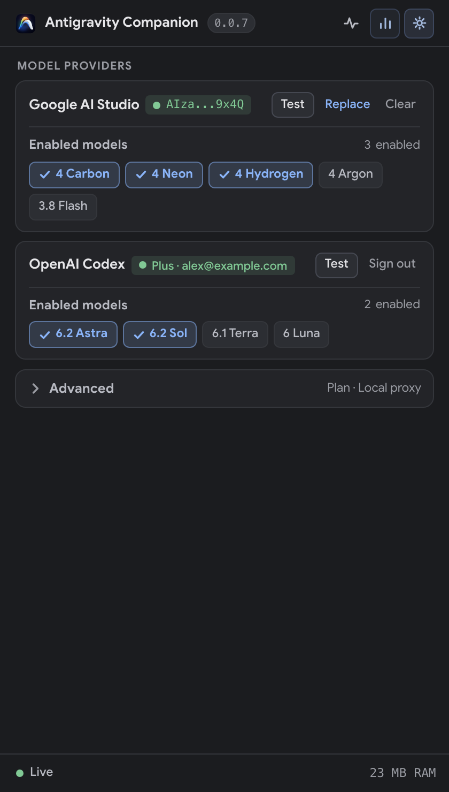
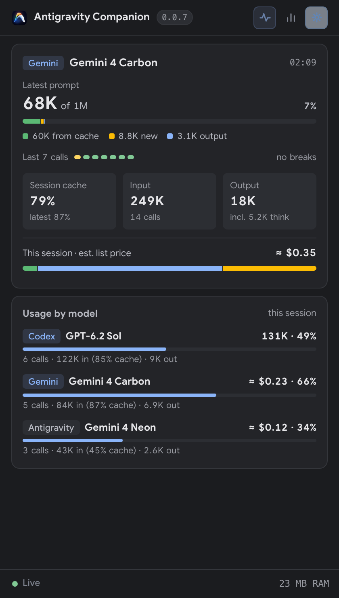
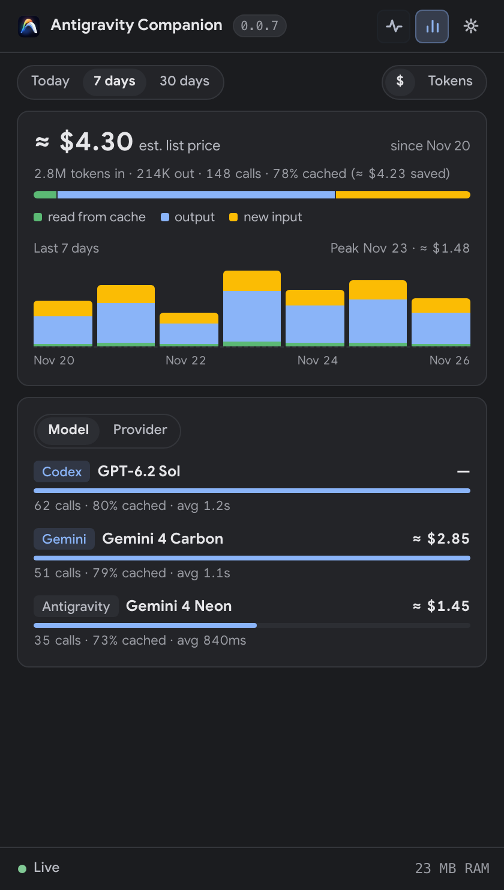

<p align="center">
  
</p>

<h1 align="center">❤️ Antigravity Companion ❤️</h1>

<p align="center">
  <strong>Love Antigravity, but paying for other AI subscriptions that sit idle?</strong><br />
  Use your <strong>ChatGPT</strong> subscription and <strong>Gemini API</strong> keys right inside Antigravity — alongside your built-in models — with live context, cache, and cost tracking.
</p>

<p align="center">
  <a href="https://github.com/Jacksunwei/agy-companion/blob/main/LICENSE"></a>
  <a href="https://www.npmjs.com/package/agy-companion"></a>
  <a href="https://pypi.org/project/agy-companion/"></a>
  <a href="https://github.com/Jacksunwei/agy-companion/blob/main/Cargo.toml"></a>
  
  <a href="https://github.com/Jacksunwei/agy-companion/blob/main/CONTRIBUTING.md"></a>
</p>

<p align="center">
  <a href="#why-antigravity-companion">Why</a> ·
  <a href="#what-works-today">Providers</a> ·
  <a href="#install">Install</a> ·
  <a href="#usage">Usage</a> ·
  <a href="#privacy--security">Security</a> ·
  <a href="#contributing">Contributing</a>
</p>

---

## Why Antigravity Companion?

- **One workspace, all your subscriptions** — Stay in Antigravity and tap into your **ChatGPT** subscription or **Gemini API** quota right inside the native model picker. No more switching editors just to avoid wasting quota you already pay for. *(Claude, Ollama Cloud, and OpenAI-compatible providers coming soon.)*
- **Your built-in models stay untouched** — Keep your existing Antigravity plan models right where they are. Nothing gets overwritten, and you can switch between built-in and personal models mid-project.
- **Live context, cache & spend in one panel** — Watch real-time context window fill, prompt cache savings, and daily/monthly spend in a native **Monitor | Usage | Settings** side panel — works automatically for built-in Antigravity models even before you connect an external account.
- **Invisible, fast, and 100% local** — Open Antigravity from your Dock, Spotlight, desktop launcher, or Start Menu like you always do. Everything runs locally on your machine with full prompt-cache discounts, zero cloud middleman, and a clean one-command uninstall.

---

## What Works Today

| Provider | How You Connect | Models You Unlock | Status |
| --- | --- | --- | --- |
| **Built-in Antigravity Models** | Automatic (zero setup) | All your existing Antigravity models + live **Monitor** & **Usage** tracking | **Ready** |
| **ChatGPT (OpenAI Codex)** | One-click ChatGPT sign-in | `GPT-6.2 Astra`, `GPT-6.2 Sol`, `GPT-6.1 Terra`, `GPT-6 Luna` (`Low`–`XHigh` reasoning) | **Ready** |
| **Gemini API** | Paste your API key | `Gemini 4 Carbon`, `Gemini 4 Neon`, `Gemini 4 Hydrogen`, `Gemini 4 Argon`, `Gemini 3.8 Flash` | **Ready** |
| **Ollama Cloud & OpenAI-Compatible** | API key or local endpoint | Ollama Cloud, local Ollama, OpenRouter, vLLM, LM Studio, OpenAI API | **Coming Soon** — Contributors Welcome |
| **Anthropic Claude** | Subscription or API key | Claude models directly inside Antigravity | **Coming Soon** — Contributors Welcome |

---

## Install

```bash
# One-command install (Node >= 18)
npx -y agy-companion@latest install

# Or install globally via npm
npm i -g agy-companion && agy-companion install

# Or via uv
uvx --refresh agy-companion install
```

> **Release channels:** Prebuilt binaries for macOS (`arm64`/`x64`), Linux (`x64`/`arm64`), and Windows (`x64`) are published via [GitHub Releases](https://github.com/Jacksunwei/agy-companion/releases), [npm](https://www.npmjs.com/package/agy-companion), and [PyPI](https://pypi.org/project/agy-companion/) on each `v*.*.*` tag (see [`docs/design/release-pipeline.md`](https://github.com/Jacksunwei/agy-companion/blob/main/docs/design/release-pipeline.md)). To run from a local checkout instead, see [Build from Source](https://github.com/Jacksunwei/agy-companion/blob/main/CONTRIBUTING.md#build-from-source).

<details>
<summary>Upgrade, Uninstall, Full Purge &amp; Troubleshooting</summary>

- **Upgrade:** Re-run `npx -y agy-companion@latest install` (or `npm i -g agy-companion@latest && agy-companion install`).
- **Uninstall (keeps your config and usage history):**
  ```bash
  npx -y agy-companion@latest uninstall
  # or, if already on $PATH:
  agy-companion uninstall
  ```
- **Full purge (also removes config, credentials, usage history, and logs):**
  ```bash
  npx -y agy-companion@latest uninstall --purge
  ```
- **One-shot launch (without shell hook):** `agy-companion launch`
- **Diagnostics:** `agy-companion doctor`

See [`docs/design/dock-launcher-and-install.md`](https://github.com/Jacksunwei/agy-companion/blob/main/docs/design/dock-launcher-and-install.md) and [`plugin/README.md`](https://github.com/Jacksunwei/agy-companion/blob/main/plugin/README.md) for lifecycle details and troubleshooting.

</details>

---

## Usage

1. **Open Antigravity** from your Dock, Spotlight, or launcher *(if it's already running, quit completely first — `Cmd+Q` on macOS — and reopen it; on Windows, launch **Antigravity (Companion)** from the Start Menu)*.
2. **Open the panel** — click **Antigravity Companion** in the side panel `+` menu, the left sidebar **Plugins** view, or just ask Antigravity: *"Open the Antigravity Companion settings panel"*.
3. **Connect your subscriptions** (or watch live **Monitor** & **Usage** stats for your built-in models right away):
   - **ChatGPT (OpenAI Codex):** Click **Sign in with ChatGPT** and pick the `GPT-6.x` models you want in your model picker.
   - **Gemini API:** Paste your [Gemini API key](https://aistudio.google.com/api-keys) and click **Save** — your enabled Gemini models appear right alongside Antigravity's built-in models.

<table>
  <tr>
    <td align="center" width="33%">
      
      <br />
      <sub><strong>Settings</strong> — Connect ChatGPT &amp; Gemini, toggle models</sub>
    </td>
    <td align="center" width="33%">
      
      <br />
      <sub><strong>Monitor</strong> — Live context, cache hits &amp; session cost</sub>
    </td>
    <td align="center" width="33%">
      
      <br />
      <sub><strong>Usage</strong> — Multi-day spend, cache savings &amp; trends</sub>
    </td>
  </tr>
</table>

---

## Privacy & Security

Antigravity Companion runs strictly locally (`127.0.0.1`) — your prompts, code, and credentials stay on your machine, and local usage tracking records token counts and latency only. See [`SECURITY.md`](https://github.com/Jacksunwei/agy-companion/blob/main/SECURITY.md) for vulnerability reporting and security details.

---

## Contributing

Contributions are welcome — especially new provider adapters (Ollama Cloud, OpenAI-compatible endpoints, Claude), UX improvements, and platform polish. See [`CONTRIBUTING.md`](https://github.com/Jacksunwei/agy-companion/blob/main/CONTRIBUTING.md) for setup, architecture, and development guidelines, or open a [Provider Adapter proposal](https://github.com/Jacksunwei/agy-companion/issues/new?template=provider_adapter.yml).

---

## License

Licensed under the [Apache License 2.0](https://github.com/Jacksunwei/agy-companion/blob/main/LICENSE).
