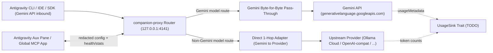

# `agy-companion` Architecture Specification

> **Status:** Approved (v1 baseline)
> **Scope:** Antigravity plugin + Rust local proxy sidecar + MCP App Settings UI + cross-platform npm/PyPI distribution.

---

## 1. Naming, Positioning & SEO/ASO Discovery

Follows the Antigravity CLI community convention (`agy-resume`, `agy-export`, `agy-discord-mcp`) for short daily CLI ergonomics while keeping full `"Google Antigravity"` visibility for human search (Google, GitHub, npm, PyPI) and agent marketplace search (`search_marketplace`):

| Surface | Value | Purpose |
| --- | --- | --- |
| **Repo / npm / PyPI / Plugin `name`** | `agy-companion` | Short, memorable install & run UX (`npx agy-companion`, `uvx agy-companion`). |
| **npm platform binary packages** | `@agy-companion/<os>-<arch>` | Scoped org packages (the `esbuild` / `turbo` / `oxlint` pattern) under `optionalDependencies`; prevents squatting and keeps npm search clean. |
| **Plugin `displayName`** | `Antigravity Companion` | Full product brand in Antigravity UI cards and Marketplace listings. |
| **Plugin `description` & keywords** | *"Bring your own models (BYOM) and track token usage and costs in Google Antigravity (agy). Runs a local Rust proxy sidecar for Gemini API (with context caching), Ollama Cloud, and more."* | Covers high-intent human & agent substrings (`antigravity`, `agy`, `byom`, `model`, `proxy`, `sidecar`, `gemini`, `cache`, `ollama`, `usage`, `cost`, `companion`). |
| **CLI binaries (`bin` / `scripts`)** | `agy-companion` + short alias `agyc` | Natural everyday command (`agy-companion serve`, `agyc doctor`, `agyc usage`). |

---

## 2. Antigravity Integration Surfaces & Plugin Architecture

| Antigravity Surface | Official Custom Endpoint Hook | Wire Format | How `agy-companion` Integrates |
| --- | --- | --- | --- |
| **Antigravity CLI (`agy`)** | `modelProvider: "gemini"` + `GEMINI_API_KEY` + `GOOGLE_GEMINI_BASE_URL` + `customModelsConfig` (`gemini-api://<base_url>/models/<model>`) | **Gemini API** | Native `/model` picker entries pointing directly at `http://127.0.0.1:<port>`. |
| **IDE Extensions** (Xcode, Zed, JetBrains, etc.) | `"auth": { "type": "gemini-api-key" }` + `GOOGLE_GEMINI_BASE_URL` | **Gemini API** | Points directly at local `agy-companion` proxy. |
| **Antigravity SDK** | `GEMINI_API_KEY` + `GOOGLE_GEMINI_BASE_URL` | **Gemini API** | Points directly at local `agy-companion` proxy. |
| **Antigravity App (desktop)** | Manages plugin **Sidecars** and **MCP Apps (`v2.34.0+`)**; no documented `customModelsConfig` yet | **Gemini API** (when exposed) | Sidecar manages `agy-companion serve`; **MCP App** renders the native Settings & Status UI in the side panel (`aux_pane`) and full-page sidebar (`global`). |

### Plugin Bundle Components (Single Rust Binary Powers Both)

| Component | Path | Role |
| --- | --- | --- |
| **Sidecar** | `plugin/sidecars/proxy/sidecar.json` | Launches `agy-companion serve` on `127.0.0.1:<port>` with automatic restart and logs under `~/.gemini/antigravity/sidecar_data/`. |
| **MCP App UI** | `plugin/mcp_config.json` | Launches `agy-companion ui-mcp` (stdio via `rmcp`), serving an embedded single-file `ui://companion/settings.html` resource with `com.google.antigravity/ui.entrypoints: ["aux_pane", "global"]`. Used strictly for UI & settings management, *not* as a model-calling wrapper. |
| **Skill** | `plugin/skills/companion/SKILL.md` | Guides `customModelsConfig` setup, opens the Settings panel, runs health checks (`agy-companion doctor`), and inspects status/usage. |

---

## 3. Repository Layout & Zero-Prereq Distribution

### Distribution Channels (No Node or Python Required at Runtime)

The core artifact is a standalone, zero-dependency native Rust binary built once per target (`darwin-arm64`, `darwin-x64`, `linux-x64`, `linux-arm64`, `win32-x64`). The `ui/` frontend compiles to a single HTML file at build time and embeds into `companion-ui-mcp` via `include_str!`. End users need **zero** Node, Python, or Rust installed at runtime:

| Channel | Runtime Required | How It Works |
| --- | --- | --- |
| **Plugin launcher** *(zero-prereq default)* | None | Shared POSIX launcher (`plugin/scripts/run-companion.sh`) used by both `sidecar.json` (`serve`) and `mcp_config.json` (`ui-mcp`): checks (1) `agy-companion` on `$PATH`, (2) cached binary in `$ANTIGRAVITY_EXECUTABLE_DATA_DIR/bin/` or `${PLUGIN_DATA}/bin/`, or (3) auto-downloads the SHA-256-verified binary from GitHub Releases on first run. |
| **Direct binary / install script / Homebrew** | None | `curl -fsSL ... \| sh` (same pattern as `agy` CLI). |
| **npm** (`esbuild` / `turbo` / `oxlint` pattern) | Node (only if chosen) | Unscoped meta-package `agy-companion` + scoped `@agy-companion/<os>-<arch>` `optionalDependencies` + thin `bin/agy-companion.js` `execFileSync` shim. |
| **PyPI** (`ruff` / `uv` pattern) | Python / `uv` (only if chosen) | `maturin` (`bindings = "bin"`) platform wheels shipping the same binary + thin Python launcher. |

### Repository Tree

```text
agy-companion/
├── AGENTS.md                         # Canonical agent contract
├── .agents/                          # Antigravity repo rules & skills
├── Cargo.toml                        # Cargo workspace root (single version source of truth)
├── Cargo.lock
├── crates/
│   ├── companion-core/               # Pure Rust domain (zero network/fs I/O):
│   │                                 #   routing config (schema_version = 1), usage metadata parser,
│   │                                 #   UsageEvent / UsageSink trait, secret redaction helpers
│   ├── companion-providers/          # Upstream provider adapters (raw reqwest + rustls, direct 1-hop Gemini <-> Provider):
│   │                                 #   M1: gemini (byte-for-byte streaming pass-through + usage tee)
│   │                                 #   M4: openai_compat (Ollama Cloud, local Ollama, OpenRouter, vLLM)
│   │                                 #   M2/M3 (deferred): codex / claude
│   ├── companion-proxy/              # Axum/Hyper local HTTP server, SSE streaming, /health, /api/stats, UsageSink wiring
│   ├── companion-ui-mcp/             # Stdio MCP App server via `rmcp` (`ui://companion/settings.html` via include_str!,
│   │                                 #   aux_pane + global entrypoints, redacted settings read/write tools)
│   └── companion-cli/                # Single binary `agy-companion` (`serve`, `ui-mcp`, `models`, `doctor`, `usage` [TODO])
├── ui/                               # MCP App frontend (Vite + @modelcontextprotocol/ext-apps + vite-plugin-singlefile)
│   ├── package.json                  # Build-time only; outputs single HTML file embedded into companion-ui-mcp
│   └── src/                          # Settings panel, proxy status, cache telemetry, customModelsConfig helper
├── packages/
│   ├── npm/
│   │   ├── agy-companion/            # Meta package: package.json (`optionalDependencies`: @agy-companion/*) + bin/agy-companion.js
│   │   └── platforms/                # Per-target package generator (`@agy-companion/<os>-<arch>`)
│   └── python/
│       ├── pyproject.toml            # Maturin `bindings = "bin"` -> PyPI `agy-companion`
│       └── python/agy_companion/     # Thin Python launcher shim
├── plugin/                           # Distributable Antigravity plugin (`agy plugin validate --strict ./plugin`)
│   ├── plugin.json                   # Manifest (version synced from Cargo.toml)
│   ├── README.md                     # Pre-install / Marketplace docs
│   ├── mcp_config.json               # Launches `run-companion.sh ui-mcp --data-dir=${PLUGIN_DATA}`
│   ├── scripts/
│   │   └── run-companion.sh          # Zero-prereq binary resolver & launcher (shared by sidecar + MCP App)
│   ├── sidecars/
│   │   └── proxy/
│   │       └── sidecar.json          # Launches `run-companion.sh serve` managed by Antigravity App
│   └── skills/
│       └── companion/
│           └── SKILL.md              # Open settings panel, configure customModelsConfig, run doctor
├── docs/
│   ├── design/                       # Architecture specs, implementation plans, TODO design notes
│   └── decisions/                    # ADRs
└── scripts/
    └── agent_check.sh                # Local Gate 1: repo checks + cargo test + version sync + agy plugin validate --strict ./plugin
```

---

## 4. Core Proxy Pipeline: Single Inbound Schema, Direct Adapters

Because Antigravity CLI, IDE extensions, and SDK all speak **one inbound wire format — the Gemini API** (`/v1beta/models/{model}:generateContent` & `:streamGenerateContent`) — **no Canonical IR is needed**. Direct 1-hop `Gemini ↔ Provider` adapters already scale `O(N)`, halve boilerplate, and avoid losing Gemini-native fields (thought signatures, `parts`, `cachedContent`) through a middle struct.



If a second inbound format is ever added later, shared types can be factored into an IR when real duplication exists.

---

## 5. Provider Roadmap & Milestone 1 Design

### Milestone 1 (v1 Core): Gemini via API Key + Implicit Cache Observability + Aux Panel Settings UI

#### A. Proxy & Implicit Context Caching (Raw HTTP Pass-Through)
- **Endpoint, Auth & Client:** Official Gemini API (`https://generativelanguage.googleapis.com/v1beta`, `x-goog-api-key` header — never `?key=` in URLs) via raw `reqwest` + `rustls` streaming with a 15-minute streaming timeout (matching Gemini 4 guidance for long thinking turns).
- **Byte-for-Byte Implicit Cache Preservation:** Gemini 2.5, 3, and 4 enable **implicit caching by default** (95% discount on Gemini 4 cache hits; explicit `cachedContents` is not supported on Gemini 4 Argon and onward). Forwarding the request bytes untouched keeps `systemInstruction`, `tools`, and conversation prefix byte-for-byte deterministic across turns and passes through any client-provided `cachedContent` for older Gemini 2.5/3 callers.
- **Zero-Buffering Usage & Cache Observability:** Stream SSE chunks directly to `agy` while tee-ing `usageMetadata` (`promptTokenCount`, `candidatesTokenCount`, `cachedContentTokenCount`, `thoughtsTokenCount`) into in-memory rolling stats (`GET /api/stats`) and the non-blocking `UsageSink` JSONL writer.
- **Live End-to-End Verification:** Verify live against the local `agy` binary via `GOOGLE_GEMINI_BASE_URL=http://127.0.0.1:<port>`.

#### B. Aux Panel Settings UI (`companion-ui-mcp` via `rmcp` + `ui/`)
- **Surfaces:** Registered with `aux_pane` (side panel `+` menu / beside chat) and `global` (full-page from **Plugins** in left sidebar) entrypoints, themed with Antigravity host CSS variables (`--color-background-*`, `--color-text-*`, `--color-border-*`).
- **M1 Controls:**
  1. **Proxy Status Bar:** Live sidecar state (`127.0.0.1:4141`), version, and binary-vs-plugin skew badge.
  2. **Gemini Provider Settings:** Write-only API key input, default model/alias mapping, upstream base URL override, and **Test Connection** button.
  3. **Cache & Telemetry Panel:** Live implicit cache hit-rate (`cachedContentTokenCount / promptTokenCount`) and recent request metrics from `GET /api/stats`.
  4. **Antigravity Setup Helper:** Copyable `customModelsConfig` (`gemini-api://http://127.0.0.1:4141/models/...`) JSON snippet for `~/.gemini/antigravity-cli/settings.json`.
  5. **Future Tab Slot (TODO):** Usage & Cost dashboard (scales naturally in the `global` full-page view).

#### C. Configuration, Usage Data Paths & Atomic Persistence

Path resolution lives in pure, deterministic helpers in `companion-core` and applies identically across `serve`, `ui-mcp`, `doctor`, and `models`:

**Resolution Precedence:**

| Artifact | Precedence (Highest → Lowest) | Validation & XDG Rules |
| --- | --- | --- |
| **Config file** | 1. `--config <path>` CLI flag<br>2. `AGY_COMPANION_CONFIG` env var<br>3. `$XDG_CONFIG_HOME/agy-companion/config.json`<br>4. Platform default (table below) | Explicit overrides (`--config`, `AGY_COMPANION_CONFIG`) and `XDG_CONFIG_HOME` values are validated via `validate_path` and platform-aware traversal/NUL checks (any `..` traversal or NUL byte fails closed with `InvalidPath`, even on relative traversal payloads). Per the XDG Base Directory Specification, unset, empty/whitespace, or benign relative `XDG_CONFIG_HOME` values (without `..` or NUL) are ignored and fall back to the platform default. Higher-precedence valid overrides short-circuit lower tiers. |
| **Usage data directory** | 1. `config.usage_dir`<br>2. `$XDG_DATA_HOME/agy-companion/usage`<br>3. Platform default (table below) | `config.usage_dir` and `XDG_DATA_HOME` values reject `..` traversal and NUL bytes fail-closed with `InvalidPath` (even on relative traversal payloads). Unset, empty/whitespace, or benign relative `XDG_DATA_HOME` values are ignored and fall back to the platform default. Writes append-only `YYYY-MM.jsonl` files inside the resolved directory. |

**Platform Defaults:**

| Platform | Default Config File | Default Usage Data Directory |
| --- | --- | --- |
| **macOS & Linux** (`#[cfg(not(windows))]`) | `~/.config/agy-companion/config.json` *(intentional XDG default on macOS — no `~/Library/Application Support/` drift)* | `~/.local/share/agy-companion/usage` |
| **Windows** (`#[cfg(windows)]`) | `%APPDATA%\agy-companion\config.json` *(via `dirs::config_dir()`, falling back to `%USERPROFILE%\.config\agy-companion\config.json` if unavailable)* | `%LOCALAPPDATA%\agy-companion\usage` *(via `dirs::data_local_dir()`, falling back to `%USERPROFILE%\.local\share\agy-companion\usage` if unavailable)* |

**Atomic Persistence & Platform Hardening (`Config::save_secure`):**
- Writes JSON to a unique sibling temp file, flushes with `sync_all()`, closes the handle, and atomically replaces the target via `fs::rename` (cleaning up the temp file on any error).
- **Unix (`#[cfg(unix)]`):** Creates missing parent directories with mode `0700` and enforces mode `0600` on config files and JSONL usage logs.
- **Windows (`#[cfg(windows)]`):** Relies on NTFS user-profile ACLs under `%APPDATA%` / `%LOCALAPPDATA%` and wraps `fs::rename` in a bounded retry (`3` attempts total with `25ms` → `50ms` backoff) retrying **only** on transient `ErrorKind::PermissionDenied` (such as concurrent reads or Windows Defender scans), immediately returning all other errors and removing the temp file only after failure.

### Milestones 2 & 3 (Deferred Until After M1): Codex Pro & Claude Subscriptions

- Deferred until Milestone 1 ships and stabilizes.
- M1 establishes a clean async `ProviderAdapter` trait in `companion-providers` so new backends plug into `companion-proxy` with zero router changes.
- When entering M2/M3, evaluate reference patterns (such as `openclaw`) alongside sanctioned options: official CLI subprocess adapters (`codex` / `claude`) and official API key adapters (`OPENAI_API_KEY` / `ANTHROPIC_API_KEY`).

### Milestone 4: Ollama Cloud (and OpenAI-Compatible Providers)

- Ollama Cloud supports Ollama Native (`/api/chat`), OpenAI (`/v1/chat/completions`), and Anthropic (`/v1/messages`), **not** the Gemini API schema.
- Build a direct 1-hop `Gemini ↔ OpenAI Chat Completions` adapter targeting `https://ollama.com/v1/chat/completions` (`Authorization: Bearer <OLLAMA_API_KEY>`).
- The exact same adapter immediately unlocks **local Ollama** (`http://127.0.0.1:11434/v1`), **OpenRouter**, **vLLM**, **LM Studio**, and **OpenAI API** via config profiles.

---

## 6. Deferred Work (TODOs) & Day-1 Seams

- **Usage & Cost Tracking Shim:** See [`docs/design/usage-tracking-todo.md`](usage-tracking-todo.md). Day-1 seam: `UsageEvent` struct + non-blocking `UsageSink` trait + append-only JSONL writer (`YYYY-MM.jsonl` under the resolved usage directory: `config.usage_dir` → `$XDG_DATA_HOME/agy-companion/usage` → `~/.local/share/agy-companion/usage` on macOS/Linux or `%LOCALAPPDATA%\agy-companion\usage` on Windows; see Section 5.C).
- **User Version Upgrades:** See [`docs/design/upgrade-lifecycle-todo.md`](upgrade-lifecycle-todo.md). Day-1 seams: single version source of truth (`Cargo.toml`), config `schema_version = 1`, and `GET /health` returning `{ "version", "protocol_version" }`.

---

## 7. Security & Hardening Invariants

All Milestone 1 components enforce the following boundaries:

1. **Loopback-Only Binding:** `companion-proxy` MUST bind exclusively to `127.0.0.1` (never `0.0.0.0`).
2. **Secret Redaction & Storage:**
   - Because `agy` CLI ignores MCP `_meta.ui.visibility: ["app"]`, `get_settings` MUST NEVER return plaintext API keys — only redacted hints (`configured: true, hint: "AIza...9x2Q"`).
   - Store secrets outside any workspace via atomic temp-file + rename persistence (`Config::save_secure`): Unix enforces mode `0600` files / `0700` parent directories; Windows stores under user-profile ACLs (`%APPDATA%`) with a bounded retry (`3` attempts, `25ms` → `50ms` backoff) on transient `ErrorKind::PermissionDenied` during rename. Never log API keys or send them in URL query parameters (always use `x-goog-api-key` header).
3. **Frontend XSS & CSP Discipline (`ui/`):**
   - Rely on MCP App default strict CSP (`default-src 'none'`); no external CDN scripts or `connectDomains` (all backend calls go through MCP `app.callServerTool`).
   - Zero `innerHTML`, `outerHTML`, `document.write`, or `dangerouslySetInnerHTML` — build DOM strictly with `textContent`, `document.createElement`, and `replaceChildren`.
   - Persist edits eagerly via `save_settings` (Antigravity does not send `ui/resource-teardown`).
4. **Upstream URL & Path Validation:**
   - Upstream remote base URLs must use `https://` (allow `http://127.0.0.1` / `http://localhost` only for local providers or tests).
   - Validate all explicit config/data paths (`--config`, `AGY_COMPANION_CONFIG`, `config.usage_dir`, `--data-dir`) and `XDG_CONFIG_HOME` / `XDG_DATA_HOME` values against traversal (`..`) and NUL bytes (fail-closed, including relative traversal payloads), while ignoring unset, empty/whitespace, or benign relative XDG env vars per the XDG Base Directory Specification; verify SHA-256 checksums before executing any binary downloaded by `plugin/scripts/run-companion.sh`.
5. **Minimal HTTP Method Surface & Headers:** Proxy exposes only required methods (`GET`, `POST`) and sets `X-Content-Type-Options: nosniff` and `Cache-Control: no-store` on internal `/health` and `/api/stats` endpoints.
