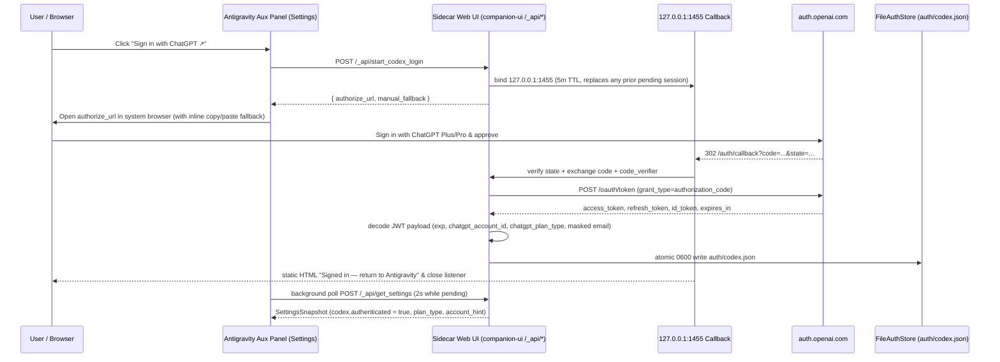
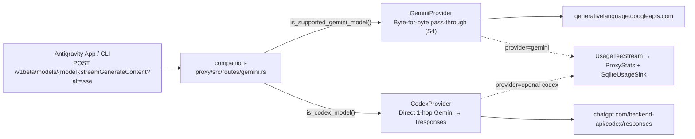

# OpenAI Codex Provider & Unified `auth/` Storage Design

> **Status:** Proposed (Ready for Implementation)
> **Scope:** Unified secret-free `config.json` + sibling `auth/` `AuthStore` across all providers (`gemini`, `codex`, future), one-click Aux Panel OAuth 2.0 PKCE login (`auth.openai.com`) with zero terminal required, direct 1-hop `Gemini GenerateContent ↔ OpenAI Codex Responses API` streaming translator, Antigravity model-picker injection (`M351..=M364`), and UX v2 Settings card.
> **Non-Goals (This Milestone):** CLI `auth codex` subcommands (login happens directly from the Antigravity Aux Panel); `~/.codex/auth.json` token sharing (avoids rotating refresh-token conflicts); OS Keychain backend (deferred behind `AuthStore` until release binaries are code-signed); OpenAI Platform `OPENAI_API_KEY` billing mode (kept cleanly pluggable behind `CodexAuth`); Anthropic/Claude or Ollama adapters.

---

## 1. Motivation & Design Goals

1. **Bring ChatGPT Plus/Pro Codex subscriptions into Antigravity (OpenClaw pattern):** Let users sign in once with their existing ChatGPT Plus or Pro subscription via OAuth 2.0 PKCE (`auth.openai.com`) and select OpenAI Codex models directly inside Antigravity's native model picker—with working thinking-effort levels, tool calling, streaming reasoning summaries, and usage/cache telemetry—without paying per-token API fees or installing Node/Python/Codex CLI at runtime.
2. **Clean pre-release credential separation (`config.json` vs `auth/`):** Because `agy-companion` is unreleased, make the clean architectural break now with **zero legacy dual-read or migration baggage**:
   - `config.json` stores **non-secret settings only** (proxy port, enabled models, Antigravity plan, launcher auto-start).
   - All provider credentials live in a sibling `0700` `auth/` directory as `0600` atomic JSON files managed by a single `AuthStore` trait in `companion-core`.
   - Background Codex OAuth token refreshes write only `auth/codex.json`—never rewriting `config.json` or triggering proxy config hot-reloads.
3. **Zero external runtime dependencies & S1–S8 parity:** Preserve the single native Rust binary (`#![forbid(unsafe_code)]`), loopback-only network boundaries (S1), zero secret leaks (S2), SSRF defenses (S3), zero-compression streaming (S4), pure-DOM CSP-strict UI (S5), and XDG/Windows fail-closed path rules (S6).

---

## 2. Unified Credential Storage Architecture (`AuthStore`)

### 2.1 On-Disk Layout & Path Derivation

Credentials live in an `auth/` directory **sibling to the resolved `config.json`**:

```text
<config_dir>/                   # e.g. ~/.config/agy-companion/ or %APPDATA%\agy-companion\
├── config.json                 # Non-secret settings ONLY (proxy, cloudcode, provider model prefs)
└── auth/                       # 0700 dir (Unix) / user-profile ACL (Windows) — RejectSymlinkAndTighten
    ├── gemini.json             # 0600 atomic — Google AI Studio API key (moved out of config.json)
    ├── codex.json              # 0600 atomic — ChatGPT/Codex OAuth tokens + non-secret account metadata
    └── .codex-refresh.lock     # 0600 cross-process lock serializing rotating OAuth refresh-token grants
```

Runtime and telemetry state remains cleanly separated under XDG data (`~/.local/share/agy-companion/` or `%LOCALAPPDATA%\agy-companion\`): `usage/usage.db`, `env.sh`, `proxy.pid`, `proxy.log`, `integration.lock`.

**Why sibling to `config.json`?**
Deriving `auth_dir = config_path.parent().unwrap_or(Path::new(".")).join("auth")` means every existing isolation mechanism (`--config <path>`, `AGY_COMPANION_CONFIG`, `XDG_CONFIG_HOME`) **automatically isolates credentials** with zero extra CLI flags or env vars.

### 2.2 Clean Pre-Release Schema Break (Zero Legacy Shim)

- Remove `api_key: Option<ApiKey>` from `GeminiConfig` and `RawGeminiConfig` in `crates/companion-core/src/config.rs`.
- Because `RawGeminiConfig` uses standard serde deserialization (without `deny_unknown_fields`), any pre-existing developer `config.json` containing an old `"api_key"` field will simply ignore it on load and omit it on the next save—zero crash, zero migration code.
- `Config::redacted_with_auth(&auth_snapshot)` (or `RedactedConfig::from_config_and_auth(&config, &auth_status)`) builds the redacted snapshot from non-secret `Config` plus `AuthStore` metadata so `companion-ui` and `ui/` keep their exact redacted wire contract (`providers.gemini.api_key_configured`, `providers.gemini.api_key_hint`) plus new redacted `providers.codex` auth status.
- `save_settings` in `companion-ui` continues to accept `providers.gemini.api_key: Option<ApiKeyPatch>`, routing that patch directly to `AuthStore::save_gemini` / `clear_gemini` instead of `config.json`.

### 2.3 `AuthStore` Trait & Implementations (`crates/companion-core/src/auth.rs`)

```rust
pub const AUTH_SCHEMA_VERSION: u32 = 1;
pub const MAX_AUTH_FILE_BYTES: u64 = 64 * 1024; // 64 KiB

#[derive(Clone, PartialEq, Eq, Serialize, Deserialize)]
pub struct GeminiCredentials {
    pub schema_version: u32,
    pub api_key: ApiKey, // printable-ASCII validated, placeholder quarantined, redacted Debug
}

#[derive(Clone, PartialEq, Eq, Serialize, Deserialize)]
pub struct CodexCredentials {
    pub schema_version: u32,
    pub auth_mode: CodexAuthMode,         // ChatGptOAuth (future: ApiKey)
    pub access_token: SecretString,       // redacted Debug, never logged or exposed in Sidecar UI
    pub refresh_token: SecretString,      // redacted Debug
    pub id_token: Option<SecretString>,   // redacted Debug
    pub account_id: String,               // ChatGPT workspace/account ID for `chatgpt-account-id` header
    pub expires_at_ms: u64,               // UTC epoch ms extracted from JWT `exp` (or `expires_in`)
    pub plan_type: Option<String>,        // e.g. "pro", "plus", "team", "enterprise" (non-secret UI badge)
    pub email_hint: Option<String>,       // masked display hint e.g. "j***@example.com" (non-secret)
    pub last_refresh_utc: String,         // RFC 3339 UTC timestamp
}

pub trait AuthStore: Send + Sync {
    fn auth_dir(&self) -> Option<&Path>;

    fn load_gemini(&self) -> Result<Option<GeminiCredentials>, CoreError>;
    fn save_gemini(&self, creds: &GeminiCredentials) -> Result<(), CoreError>;
    fn clear_gemini(&self) -> Result<(), CoreError>;

    fn load_codex(&self) -> Result<Option<CodexCredentials>, CoreError>;
    fn save_codex(&self, creds: &CodexCredentials) -> Result<(), CoreError>;
    fn clear_codex(&self) -> Result<(), CoreError>;
}
```

#### `FileAuthStore` Security & Concurrency Properties
- **Fail-closed reads (S6):** Uses `fs_safe::read_regular_file_utf8_bounded(&path, MAX_AUTH_FILE_BYTES, SymlinkPolicy::Reject)` after verifying `auth/` itself is not a symlink (`fs_safe::inspect_existing_dir`). Rejects symlinks, FIFOs, oversized files, `..`, and NUL bytes.
- **Atomic `0600`/`0700` writes (S2):** Uses `fs_safe::write_atomic` with:
  - `file_mode: 0o600`, `dir_mode: 0o700`
  - `parent_policy: ParentDirPolicy::RejectSymlinkAndTighten`
  - `target_policy: TargetFilePolicy::RejectSymlinkAndNonRegular`
- **Safe deletion (`clear_*`):** Rejects symlink target before `fs::remove_file` (ignores `ErrorKind::NotFound`).
- **Lightweight hot-observation without touching `config.json`:** `FileAuthStore` caches `(FileStamp, Option<T>)` per credential file (or checks `inspect_file_stamp` off-thread in `companion-proxy`), so:
  - Saving a Gemini key or completing **Sign in with ChatGPT ↗** in the Aux Panel is observed on the **very next request** and **very next `fetchAvailableModels`** with zero proxy restart.
  - Background Codex token refresh writes `auth/codex.json` without ever dirtying `config.json`.
- **Test & future Keychain seams:**
  - `MemoryAuthStore` enables fast, hermetic unit tests with zero disk I/O.
  - A future `KeychainAuthStore` (if binaries are later Apple/Windows code-signed) implements `AuthStore` without changing a single provider, proxy, Sidecar UI, or CLI caller.

---

## 3. Configuration & Redacted View Extensions

### 3.1 `Config` (`schema_version = 1`, additive)

```rust
#[derive(Debug, Clone, PartialEq, Eq, Serialize, Deserialize)]
#[serde(default)]
pub struct CodexConfig {
    pub base_url: String,            // default: "https://chatgpt.com/backend-api/codex"
    pub default_model: String,       // default: "gpt-6.2-sol"
    pub enabled_models: Vec<String>, // default: ["gpt-6.2-astra", "gpt-6.2-sol"]
    pub timeout_secs: u64,           // default: 900
}

#[derive(Debug, Clone, PartialEq, Eq, Default, Serialize, Deserialize)]
#[serde(default)]
pub struct ProvidersConfig {
    pub gemini: GeminiConfig,        // api_key removed!
    pub codex: CodexConfig,          // new sibling provider
}
```

### 3.2 `RedactedConfig` (`companion-core/src/redaction.rs`)

```rust
#[derive(Debug, Clone, PartialEq, Eq, Serialize, Deserialize)]
pub struct RedactedCodexConfig {
    pub base_url: String,
    pub default_model: String,
    pub enabled_models: Vec<String>,
    pub timeout_secs: u64,
    pub authenticated: bool,
    pub account_hint: Option<String>, // masked email or short account suffix, never raw JWT/token
    pub plan_type: Option<String>,    // "pro" | "plus" | "team" | "enterprise"
    pub expires_at_ms: Option<u64>,
}
```

No `access_token`, `refresh_token`, or `id_token` ever enters `RedactedConfig`, `SettingsSnapshot`, `tracing` logs, or error strings.

---

## 4. OpenAI Codex OAuth 2.0 + PKCE Authentication

### 4.1 Protocol Parameters (OpenClaw / Codex CLI Parity)

| Parameter | Value | Notes |
| --- | --- | --- |
| **Authorize endpoint** | `https://auth.openai.com/oauth/authorize` | Overridable via internal test hook only (`CODEX_OAUTH_ISSUER` in tests) |
| **Token endpoint** | `https://auth.openai.com/oauth/token` | Used for both `authorization_code` exchange and `refresh_token` grants |
| **Client ID** | `app_EMoamEEZ73f0CkXaXp7hrann` | Public PKCE client (no client secret) |
| **Redirect URI** | `http://localhost:1455/auth/callback` | Loopback listener bound strictly to `127.0.0.1:1455` (S1) |
| **PKCE** | `S256` (`32` CSPRNG bytes via `getrandom`, `sha2`, `base64` URL-safe no-pad) | All 3 crates are already present in `Cargo.lock` (zero new transitive supply-chain risk) |
| **CSRF `state`** | `32` CSPRNG bytes, verified before token exchange | Rejects mismatched or missing state fail-closed |
| **Scopes & flags** | `openid profile email offline_access`, `id_token_add_organizations=true`, `codex_cli_simplified_flow=true`, `originator=codex_cli_rs` | Matches OpenClaw / Codex CLI subscription flow |

### 4.2 Aux Panel One-Click Login Flow (Zero Terminal Required)



- **Zero terminal, resilient to closing the pane:** The `agy-companion serve` sidecar (`companion-ui` + `sidecar_ui.rs`) stays alive in Antigravity's sidecar host even if the user closes/reopens the Aux Panel while signing in on their browser, so the callback still completes and persists `auth/codex.json` cleanly.
- **Single bounded pending session:** Clicking **Sign in with ChatGPT ↗** again (or clicking **Cancel** → `cancel_codex_login`) aborts any previous pending listener and releases `127.0.0.1:1455` immediately. Pending listeners auto-expire after `5` minutes.
- **Inline fallback (still zero terminal):** If `127.0.0.1:1455` is occupied or browser launch is blocked, the card reveals a copyable sign-in URL and a compact `"Paste redirect URL"` input wired to `complete_codex_login` right inside the Aux Panel.
- **Why native PKCE instead of sharing `~/.codex/auth.json`:** OpenAI refresh tokens rotate on use. Minting our own PKCE session via the Aux Panel gives `agy-companion` an independent refresh-token family that will never log out a user's separate Codex CLI session.

### 4.3 Rotating Refresh Token Concurrency (Cross-Process Lock)

Because `agy-companion serve` (proxy + Sidecar Web UI `test_connection`) and `agy-companion doctor` can run across separate OS processes, **unserialized token refreshes would race and burn rotating single-use refresh tokens**.

Refresh protocol inside `CodexAuthManager::valid_credentials()`:
1. Fast path: load cached `CodexCredentials` (stat-checked against `auth/codex.json`); if `now_ms + 300_000 < expires_at_ms` (5-minute proactive margin), return immediately.
2. Slow path (near expiry or after an upstream HTTP `401` retry):
   - Acquire in-process `tokio::sync::Mutex` **and** cross-process `<auth_dir>/.codex-refresh.lock` (`0600`, reusing the same cross-process lock pattern as `<data_dir>/integration.lock`).
   - Re-read `auth/codex.json` under the lock. If another process/task already refreshed it (newer `expires_at_ms` or different `access_token`), return the fresh credentials without calling `auth.openai.com`.
   - Otherwise `POST https://auth.openai.com/oauth/token` (`grant_type=refresh_token`), extract updated JWT claims, atomically save `auth/codex.json` (`0600`), and release the lock.
   - On `invalid_grant` / `401` during refresh, surface a clear `ProviderError::AuthExpired("OpenAI Codex session expired — sign in again")` without deleting user model preferences.

### 4.4 Subscription Policy & Future Fallback Seam

Routing via ChatGPT Plus/Pro OAuth uses the same consumer-subscription endpoint (`chatgpt.com/backend-api/codex/responses`) as OpenClaw and Codex CLI. It is subject to ChatGPT Plus/Pro rolling rate limits and any future OpenAI policy/endpoint changes. Keeping token acquisition behind a `CodexAuth` trait means standard OpenAI Platform `OPENAI_API_KEY` (`https://api.openai.com/v1/responses`) can plug into the exact same Responses translator later with zero protocol changes.

---

## 5. Codex Model Catalog & Antigravity Slot Allocation

### 5.1 Curated GPT-6.x Codex Models & Thinking Effort Variants

Verified directly against OpenAI's official `openai/codex` `codex-rs/models-manager/models.json` (Nov 2026) — shipping only the current GPT-6.x generation tiers (omitting previous-gen / legacy `gpt-6-sol`, `gpt-6.1-sol`, `gpt-6-astra`, and `gpt-5.*` entries):

| Chip Label | Model ID | Default | Context Window | Reasoning Efforts | Slot Cost | Best-For Tooltip |
| --- | --- | :---: | ---: | --- | :---: | --- |
| **`6.2 Astra`** | `gpt-6.2-astra` | **ON** | `272K` | `Low`, `Medium`, `High`, `XHigh` | 4 | `Best for complex coding, hard debugging, architecture, and deep professional work.` |
| **`6.2 Sol`** | `gpt-6.2-sol` | **ON** | `500K` | `Low`, `Medium`, `High`, `XHigh` | 4 | `Best as the fast, go-to model for everyday coding and large-context repositories.` |
| **`6.1 Terra`** | `gpt-6.1-terra` | OFF | `500K` | `Low`, `Medium`, `High` | 3 | `Best for visual understanding, screenshots, and efficient computer-use workflows.` |
| **`6 Luna`** | `gpt-6-luna` | OFF | `272K` | `Low`, `Medium`, `High` | 3 | `Best for fast, lightweight edits and preserving ChatGPT subscription quota.` |

All four models are available on ChatGPT Plus, Pro, Team, and Enterprise plans (`available_in_plans`). Custom GPT-6+ model IDs remain valid when configured in `config.json` via `validate_codex_model()` (strict ASCII slug `[a-zA-Z0-9._-]`, `<= 128` chars, non-empty, rejecting Gemini prefix collisions).

### 5.2 Collision-Free Placeholder Slot Partition (`M334..=M365`)

In `crates/companion-proxy/src/cloudcode/slots.rs`, Antigravity provides **32 deterministic placeholder slots** (`MODEL_PLACEHOLDER_M334..=M365`):

- **Gemini curated range (`0..=16` → `M334..=M350`, 17 slots):** Unchanged—existing Gemini conversations never shift enum bindings.
- **Codex curated range (`17..=30` → `M351..=M364`, 14 slots):**
  - Default 2 Codex models (`gpt-6.2-astra`, `gpt-6.2-sol`) use **8 slots** (`M351..=M358`).
  - All 4 curated GPT-6.x Codex models enabled use **14 slots** (`M351..=M364`), leaving `M365` spare and fitting alongside **all 5 Gemini models simultaneously** (`17 + 14 = 31 <= 32`)!
- **Slot injection condition:** Codex models are merged into `POST /v1internal:fetchAvailableModels` **only when** `codex_authenticated && !codex.enabled_models.is_empty()` (mirroring Gemini's `has_configured_api_key && !gemini.enabled_models.is_empty()` gate).
- **Important Antigravity metadata differences for Codex models (`catalog.rs`):**
  - `modelUrl`: `"gemini-api://<codex-model-id>"` (routes exclusively through `GOOGLE_GEMINI_BASE_URL` → `http://127.0.0.1:<port>/v1beta/models/<codex-model-id>:streamGenerateContent?alt=sse`).
  - `displayName`: `"GPT-6.2 Astra (Codex) (High)"` (collapses into `"GPT-6.2 Astra (Codex)"` with native Low/Medium/High/Extra effort flyout via Antigravity's `EFFORT_LABEL_RE`).
  - **Do NOT blindly copy Gemini `modelExperimentIds` or `supportsThoughtCirculation: true`** from upstream Gemini templates (which would expect Gemini cryptographic `thoughtSignature` tokens). Set explicit Codex metadata:
    - `maxTokens`: model-specific (`500_000` for `gpt-6.2-sol` / `gpt-6.1-terra`; `272_000` for `gpt-6.2-astra` / `gpt-6-luna`)
    - `maxOutputTokens`: `128_000`
    - `supportsThinking`: `true`, `thinkingLevel`: `1 | 2 | 3 | 7`
    - `supportsImages`: `true`, `supportsVideo`: `false`, `supportsPdf`: `false`
    - `supportedMimeTypes`: `text/plain`, `image/png`, `image/jpeg`, `image/webp`
    - `quotaInfo`: `{ "remainingFraction": 1.0 }`

---

## 6. Direct 1-Hop Protocol Translation: Gemini ↔ OpenAI Codex Responses API



### 6.1 Upstream HTTP Request Contract

- **URL:** `POST {codex.base_url}/responses` (default `https://chatgpt.com/backend-api/codex/responses`, SSRF-validated per S3; `Policy::none()` on redirects; zero compression per S4).
- **Headers:**
  - `Authorization: Bearer <access_token>`
  - `chatgpt-account-id: <account_id>`
  - `OpenAI-Beta: responses=experimental` *(verify live header acceptance during PR 2 smoke check; keep constant centralized)*
  - `originator: codex_cli_rs`
  - `version: 0.166.0` *(or current Codex CLI client version; `gpt-6.2-*` specifies `minimal_client_version: "0.166.0"` in `models.json`)*
  - `Content-Type: application/json`
  - `Accept: text/event-stream`

### 6.2 Request Translation (`Gemini GenerateContent → Codex Responses`)

| Gemini Inbound Field | Codex Responses Outbound Field | Edge-Case Handling |
| --- | --- | --- |
| `systemInstruction.parts[].text` | `instructions: String` | Codex backend requires a non-empty `instructions` string; join text parts with `\n\n` and fall back to `"You are a helpful coding assistant."` if absent/blank. |
| *(always)* | `store: false`, `stream: true` | Required by `chatgpt.com/backend-api/codex/responses`. If the inbound caller used unary `:generateContent`, the adapter still streams upstream and aggregates into a single Gemini JSON response. |
| `contents[]` (`role: "user"`) | `input[]` `{ type: "message", role: "user", content: [...] }` | `text` → `{ type: "input_text", text }`; `inlineData` (`image/*`) → `{ type: "input_image", image_url: "data:<mime>;base64,<data>" }`; unsupported binary MIME types return a clean `400` instead of silent data loss. |
| `contents[]` (`role: "model"`) | `input[]` assistant `message` + `function_call` items | Skip `thought: true` parts and Gemini `thoughtSignature` fields. Emit `text` as `{ type: "message", role: "assistant", content: [{ type: "output_text", text }] }`. Emit each `functionCall` as `{ type: "function_call", call_id, name, arguments: json_str }`. |
| `contents[]` `functionResponse` | `input[]` `{ type: "function_call_output", call_id, output: json_str }` | **Deterministic `call_id` correlation:** Gemini may omit `functionCall.id` / `functionResponse.id`. Maintain a per-function FIFO queue of emitted `call_id`s (`call_<turn>_<idx>`, `<= 64` chars) across the history so every `functionResponse` matches its exact `function_call`. |
| `tools[].functionDeclarations[]` | `tools: [{ type: "function", name, description, parameters }]` | Normalize Gemini Schema dialect: uppercase `type` (`OBJECT`, `STRING`, `ARRAY`, `INTEGER`, `NUMBER`, `BOOLEAN`) → lowercase; convert `nullable: true` → `type: [<t>, "null"]`; strip Gemini-only keys (`propertyOrdering`, `format` values rejected by strict schema validators). |
| `toolConfig.functionCallingConfig` | `tool_choice` | `AUTO` → `"auto"`, `NONE` → `"none"`, `ANY` → `"required"`. |
| `generationConfig.thinkingConfig` | `reasoning: { effort, summary: "auto" }` | Map `thinkingLevel`: `LOW`/`1` → `"low"`, `MEDIUM`/`2` → `"medium"`, `HIGH`/`3` → `"high"`, `XHIGH`/`7` → `"xhigh"`. If only `thinkingBudget` is present, bucket `<= 2048` → `"low"`, `<= 8192` → `"medium"`, `> 8192` → `"high"`. |
| `temperature`, `topP`, `maxOutputTokens` | *(omitted by default)* | Codex backend rejects unsupported sampling/token params with HTTP `400`; omit them unless explicitly supported by the target model. |

### 6.3 Streaming Response Translation (`Codex Responses SSE → Gemini SSE`)

Every Codex SSE event (`data: { "type": "..." }`) is parsed incrementally with bounded per-event memory (reusing S4/S7 bounded framing) and transformed directly into Gemini `data: { ... }\n\n` frames:

| Codex SSE Event `type` | Emitted Gemini SSE Chunk | Notes |
| --- | --- | --- |
| `response.reasoning_summary_text.delta` | `candidates[0].content.parts = [{ text: delta, thought: true }]` | Renders natively in Antigravity's collapsible thinking block. |
| `response.output_text.delta` | `candidates[0].content.parts = [{ text: delta }]` | Zero-buffering token-by-token streaming. |
| `response.output_item.added` (`type == "function_call"`) | *(buffer `call_id`, `name`)* | Never emit partial/unparseable JSON arguments. |
| `response.function_call_arguments.delta` | *(append to item buffer, bounded)* | Bounds total argument size to prevent OOM. |
| `response.output_item.done` (`type == "function_call"`) | `candidates[0].content.parts = [{ functionCall: { id, name, args } }]` | Parse buffered JSON object (fallback `{}` if empty string) and emit cleanly once complete. |
| `response.completed` | Final chunk with `finishReason` (`"STOP"` or `"MAX_TOKENS"` if `incomplete_details.reason == "max_output_tokens"`) + `usageMetadata` | Map `input_tokens` → `promptTokenCount`, `input_tokens_details.cached_tokens` → `cachedContentTokenCount`, `output_tokens` → `candidatesTokenCount`, `output_tokens_details.reasoning_tokens` → `thoughtsTokenCount`. |
| `response.failed` / `error` | Gemini error frame / mapped HTTP status | Actionable message (`ChatGPT Codex quota limit reached`, `OpenAI Codex session expired`, etc.) with zero token leakage. |

Because the translated stream emits standard Gemini `usageMetadata`, **`UsageTeeStream` automatically records every Codex turn** into `ProxyStats` and `SqliteUsageSink` under a new `UsageOrigin::CodexProxy` (`provider = "openai-codex"`, `source = "proxy"`). Both UX v2's **Monitor** tab and **Usage** tab (`Provider` breakdown) pick up Codex traffic with zero schema changes to `usage.db`!

---

## 7. Aux Panel UX, Sidecar Web UI APIs & Diagnostics

### 7.1 Sidecar Web UI APIs (`companion-ui` + `sidecar_ui.rs` `/_api/*`)
- Extend `save_settings` with `providers.codex: Option<CodexSettingsPatch>` (`enabled_models`, `default_model`).
- Extend `test_connection` with optional `provider: Option<"gemini" | "codex">` (defaults to `"gemini"` for backward compatibility).
- Add OAuth lifecycle endpoints under `POST /_api/*` (authenticated with `X-Sidecar-Token` + `application/json`, strict `#[serde(deny_unknown_fields)]`):
  - `start_codex_login` → starts (or replaces) the bounded loopback PKCE listener on `127.0.0.1:1455` (5-min TTL) and returns `{ authorize_url, callback_listening, manual_fallback }` so the Aux Panel opens `authorize_url` in the system browser (with inline copy/paste fallback).
  - `cancel_codex_login` → aborts any pending login listener and releases `127.0.0.1:1455`.
  - `complete_codex_login` *(inline manual fallback)* → accepts a pasted redirect URL/code if port `1455` was busy or browser launch was blocked, exchanges PKCE tokens, writes `auth/codex.json`, and returns a fresh `SettingsSnapshot`.
  - `disconnect_codex` → clears `auth/codex.json`, aborts any pending login, and returns a fresh `SettingsSnapshot`.
- `SettingsSnapshot` adds `supported_codex_models: Vec<ModelPreset>` and `codex_login_pending: bool` alongside `config.providers.codex` (`RedactedCodexConfig`).

### 7.2 UX v2 Aux Panel Card (`ui/src/settings.ts`, stacked after PR C merges)
- Plugs directly into UX v2's `.provider-stack` below **`Google AI Studio`**:
  - **Signed-out state:** Header **`OpenAI Codex`** + muted `Not signed in` pill + primary **`Sign in with ChatGPT ↗`** button (calls `/_api/start_codex_login` and opens `authorize_url` in the system browser).
  - **Pending sign-in state:** Inline `"Complete sign-in in your browser…"` indicator (2s `get_settings` poll) + **`Cancel`** + secondary **`Copy link`** / collapsible `"Having trouble? Paste callback URL"` fallback (still zero terminal).
  - **Signed-in state:** Status pill (`● Pro · j***@…` or `● Plus`), **`Test`** button, right-aligned **`Sign out`** (inline 2-click confirm, zero `window.confirm()`), and **`Enabled models`** checkbox chips (`6.2 Astra`, `6.2 Sol`, `6.1 Terra`, `6 Luna`) with clamped `"Best for ..."` tooltips.

### 7.3 Diagnostics (`companion-cli`)
- No `auth codex` CLI subcommands (keeping the CLI minimal and zero-terminal-first).
- `agy-companion doctor` reports redacted status for both Gemini (`auth/gemini.json` / `GEMINI_API_KEY`) and Codex (`auth/codex.json` presence & expiry), passing cleanly whenever at least one provider is configured.

---

## 8. S1–S8 Security & Architecture Invariant Matrix

| Invariant | How Unified `auth/` + Codex Satisfies It |
| --- | --- |
| **S1 (Loopback only)** | Proxy remains `127.0.0.1` only; OAuth PKCE callback listener binds strictly to `127.0.0.1:1455` (never `0.0.0.0`). |
| **S2 (Secret redaction & atomic `0600`)** | All secrets leave `config.json` and live in `0700` `auth/{gemini,codex}.json` (`0600` atomic writes, `RejectSymlinkAndTighten` / `RejectSymlinkAndNonRegular`). `SecretString` redacts `Debug`; `RedactedConfig` never includes plaintext keys or tokens; `hyper`/`hyper_util`/`h2`/`reqwest` tracing stays capped at `INFO`. |
| **S3 (SSRF & upstream auth)** | `auth.openai.com` and `chatgpt.com` require `https://` (`http://127.0.0.1`/`localhost` only for tests); `Policy::none()` on redirects; Bearer token only in `Authorization` header (never query string). |
| **S4 (Zero compression & streaming)** | `reqwest` keeps zero compression features; Gemini fast-path stays byte-for-byte untouched; Codex SSE translates token-by-token without buffering full responses. |
| **S5 (Pure DOM & strict CSP)** | Codex UI card uses `document.createElement` / `textContent` and safe external navigation — zero `innerHTML`, `fetch()` restricted to same-origin `/_api/*` in `ui/src/transport.ts`, zero CSP relaxation, bundle stays `< 512 KiB`. |
| **S6 (XDG + Windows paths & fail-closed)** | `auth/` derives from resolved `config_path` parent (`--config` → `AGY_COMPANION_CONFIG` → `XDG_CONFIG_HOME` → platform default); `fs_safe` rejects symlinks, FIFOs, `..`, NUL bytes, and oversized files (`> 64 KiB`). |
| **S7 (HTTP surface & limits)** | No new proxy HTTP methods or endpoints needed for inference (reuses `/v1beta/models/{*rest}` and `/v1internal:fetchAvailableModels` under existing `64 MiB` limit and headers). |
| **S8 (Packaging & zero-prereq)** | Pure Rust using crates already in `Cargo.lock` (`sha2`, `base64`, `getrandom`, `reqwest`, `axum`); zero Node/Python/Codex CLI runtime requirement. |

---

## 9. Incremental Implementation & PR Sequence

Each slice is small, independently testable with hermetic Rust tests, and ordered for zero conflicts with sibling UX v2 (`PR C`) and Testing Infrastructure work:

| PR | Branch | Scope & Crates | Positive Verification Signal |
| --- | --- | --- | --- |
| **PR 0** *(now)* | `docs/openai-codex-provider-design` (or folded into PR 1) | `docs/design/openai-codex-provider.md` | `./scripts/agent_check.sh` 7/7 green |
| **PR 1** | `feat/unified-auth-store` | `companion-core` (`auth.rs` `AuthStore` + `FileAuthStore` + `MemoryAuthStore`, remove `providers.gemini.api_key` from `config.rs`, update `redaction.rs`), wire `companion-providers`, `companion-proxy`, `companion-ui`, `companion-cli` to `AuthStore`. | `cargo test --workspace` green; `config.json` contains zero `"api_key"` fields; `auth/gemini.json` created at `0600` inside `0700` `auth/`; `./scripts/agent_check.sh` 7/7 green. |
| **PR 2** | `feat/codex-core-and-oauth` | `companion-core` (`CodexConfig`, `CodexCredentials`, curated Codex models), `companion-providers::codex::auth` (PKCE S256, loopback `127.0.0.1:1455` callback manager with cancellation/TTL, manual paste fallback, JWT decode, cross-process locked refresh), `companion-cli` (`doctor` Codex check). | Hermetic mock OAuth server tests pass (happy path, state mismatch, cancel/replace pending session, concurrent refresh serialization, `invalid_grant`, symlink rejection); `./scripts/agent_check.sh` 7/7 green. |
| **PR 3** | `feat/codex-responses-proxy` | `companion-providers::codex::{translate,provider}` (`Gemini ↔ Codex Responses` SSE & unary translator, tool-call correlation, schema normalization, reasoning summaries, usage mapping), `companion-proxy` (multi-provider dispatch in `routes/gemini.rs`, `M351..=M364` slot injection in `cloudcode/{slots,catalog}.rs`, `UsageOrigin::CodexProxy`). | Hermetic mock Codex SSE server tests pass (text streaming, reasoning summaries → `thought: true`, multi-turn tool calls without Gemini `id`, `cached_tokens` → `UsageSink`, `401` refresh-and-retry, `429` error mapping, 31-slot Gemini+Codex coexistence); `./scripts/agent_check.sh` 7/7 green. |
| **PR 4** *(after PR C merges)* | `feat/codex-sidecar-ui` | `companion-ui` + `sidecar_ui.rs` (`start_codex_login`, `cancel_codex_login`, `complete_codex_login`, `disconnect_codex`, `CodexSettingsPatch`, provider-aware `test_connection`), `ui/` (one-click `Sign in with ChatGPT ↗` flow + `OpenAI Codex` card stacked in UX v2 `LIVE_PROVIDERS`), `docs/README.md` index update. | `npm --prefix ui run typecheck && npm --prefix ui run build`, S5 bundle `< 512 KiB` clean, `cargo test --workspace` green, `./scripts/agent_check.sh` 7/7 green. |
