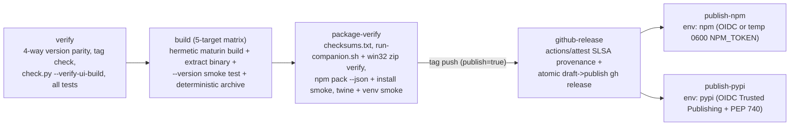

# Release Pipeline (GitHub Releases, npm & PyPI)

> **Companion Skill:** [`.agents/skills/release/SKILL.md`](../../.agents/skills/release/SKILL.md) (step-by-step release runbook, OIDC preflight, tagging, and live verification).

This document describes the automated release pipeline in [`.github/workflows/release.yml`](../../.github/workflows/release.yml) and the setup required on GitHub, PyPI, and npm before tagging a release.

## Distribution Channels & Target Matrix

Each release builds every native binary **once per target** via `PyO3/maturin-action` (`packages/python/pyproject.toml`, `bindings = "bin"`, `strip = true`), then reuses that exact stripped binary across all three distribution channels:

| Target | Rust Triple | Runner | Linux libc / macOS min | GitHub Release Asset | npm Package | PyPI Wheel |
| --- | --- | --- | --- | --- | --- | --- |
| `darwin-arm64` | `aarch64-apple-darwin` | `macos-latest` | macOS `>= 11.0` | `agy-companion-vX.Y.Z-darwin-arm64.tar.gz` | `@agy-companion/darwin-arm64` | `py3-none-macosx_11_0_arm64` |
| `darwin-x64` | `x86_64-apple-darwin` | `macos-15-intel` | macOS `>= 11.0` | `agy-companion-vX.Y.Z-darwin-x64.tar.gz` | `@agy-companion/darwin-x64` | `py3-none-macosx_11_0_x86_64` |
| `linux-x64` | `x86_64-unknown-linux-gnu` | `ubuntu-latest` | `manylinux_2_28` (glibc `>= 2.28`) | `agy-companion-vX.Y.Z-linux-x64.tar.gz` | `@agy-companion/linux-x64` | `py3-none-manylinux_2_28_x86_64` |
| `linux-arm64` | `aarch64-unknown-linux-gnu` | `ubuntu-24.04-arm` | `manylinux_2_28` (glibc `>= 2.28`) | `agy-companion-vX.Y.Z-linux-arm64.tar.gz` | `@agy-companion/linux-arm64` | `py3-none-manylinux_2_28_aarch64` |
| `win32-x64` | `x86_64-pc-windows-msvc` | `windows-latest` | MSVC | `agy-companion-vX.Y.Z-win32-x64.zip` | `@agy-companion/win32-x64` | `py3-none-win_amd64` |

Additionally:

- **GitHub Releases** publishes deterministic archives (`gzip.GzipFile(filename="", mtime=0)` + PAX tar / fixed-epoch zip), sorted `checksums.txt` (`<sha256>  <filename>`) verified against `plugin/scripts/run-companion.sh`'s `verify_sha256` and `extract_verified_binary`, categorized release notes (`.github/release.yml`), and **SLSA Build Provenance** attestations via `actions/attest` (`gh release create --draft --verify-tag` → `gh release edit --draft=false`).
- **npm** publishes the 5 `@agy-companion/<target>` binary packages first, then the `agy-companion` meta-package (`packages/npm/agy-companion/`) exposing `agy-companion` and `agyc` via `optionalDependencies`, all with Sigstore `--provenance`.
- **PyPI** publishes the 5 prebuilt `py3-none-*` binary wheels with PEP 740 attestations and `verify-metadata: true` (no source distribution, because `companion-ui` and `companion-cli` embed workspace-root `ui/dist/index.html` and `plugin/*` at compile time).

## Supply-Chain Hardening

- **Immutable action pins:** Every `uses:` step in `.github/workflows/release.yml` is pinned to a 40-character Git commit SHA (kept up to date weekly via `.github/dependabot.yml`).
- **Least-privilege permissions & checkout hygiene:** Workflow-level `permissions: {}` with minimal per-job scopes (`contents: read` for verify/build/package-verify; `contents: write`, `id-token: write`, `attestations: write` for `github-release`; `contents: read`, `id-token: write` for `publish-npm` and `publish-pypi`). Every `actions/checkout` sets `persist-credentials: false`, and `setup-node` in `package-verify` and `publish-npm` sets `package-manager-cache: false` (and never sets `registry-url`).
- **Hermetic release builds:** Cargo caching (`Swatinem/rust-cache`) is intentionally omitted from `release.yml`, and `publish-npm` fails closed if bundled `npm < 11.5.1` (no runtime `npm install -g`).
- **Verifying SLSA Build Provenance:** After a live release, verify any downloaded GitHub Release archive or `checksums.txt` with GitHub CLI:
  ```bash
  gh attestation verify agy-companion-vX.Y.Z-darwin-arm64.tar.gz --repo Jacksunwei/agy-companion
  ```

## Pipeline Stages



- **Dry-run verification:** Trigger `Release` via GitHub Actions `workflow_dispatch` with `dry_run: true` (the default) from `main`. Dry runs support both daily dev prereleases (`X.Y.Z-dev.N`, normalized by `maturin` to PEP 440 `X.Y.Z.devN` inside wheels while binaries report raw SemVer) and final releases (`X.Y.Z`), executing `verify`, all 5 `build` jobs, and `package-verify` (including real `linux-x64` npm and wheel install smoke tests) without creating a GitHub Release, public attestations, or publishing to npm/PyPI.
- **Live release (fail-closed on `-dev.N`):** Push a matching clean final SemVer tag `vX.Y.Z` (where `X.Y.Z` matches `Cargo.toml`, `plugin/plugin.json`, `packages/npm/agy-companion/package.json`, and `packages/python/pyproject.toml`). `scripts/package_release_asset.py resolve-release` and job-level `!contains(needs.verify.outputs.version, '-')` guards strictly refuse `publish: true` on any `-dev.N` version. `github-release`, `publish-npm`, and `publish-pypi` are idempotent on re-run.

## One-Time Setup (GitHub, PyPI & npm)

### 1. GitHub Environments

Create two GitHub Environments under **Settings -> Environments** on `Jacksunwei/agy-companion`:

- `pypi`
- `npm`

Restrict both environments to protected tags (`v*.*.*`) under **Deployment branches and tags -> Selected branches and tags**.

### 2. PyPI Trusted Publishing (Zero Secrets)

In [PyPI `agy-companion` Publishing Settings](https://pypi.org/manage/project/agy-companion/settings/publishing/), add a **GitHub Actions** Trusted Publisher:

- **Owner:** `Jacksunwei`
- **Repository:** `agy-companion`
- **Workflow name:** `release.yml`
- **Environment name:** `pypi`

No `PYPI_API_TOKEN` secret is needed; PEP 740 attestations are uploaded automatically.

### 3. npm Organization & Trusted Publishing

1. All 6 npm packages (`agy-companion` and `@agy-companion/{darwin-arm64,darwin-x64,linux-x64,linux-arm64,win32-x64}`) are published under the **`@agy-companion`** organization since `v0.1.0` and use tokenless **OIDC Trusted Publishing** with **zero static `NPM_TOKEN` secret** in the `npm` GitHub Environment.
2. **Trusted Publisher settings (all 6 packages):**
   - On npmjs.com, under **Settings -> Trusted Publishers -> GitHub Actions** for `agy-companion` and all 5 `@agy-companion/*` packages:
     - **Organization / user:** `Jacksunwei`
     - **Repository:** `agy-companion`
     - **Workflow filename:** `release.yml`
     - **Environment name:** `npm`
     - **`Allow npm publish`** enabled (and **"Require two-factor authentication and disallow tokens"** enabled under **Publishing access**).
   - **48-hour activation rule:** npm expires a newly configured Trusted Publisher connection if no successful OIDC publish completes within **48 hours** of adding it. If adding or rotating a Trusted Publisher connection, configure it right before cutting the release tag.
3. **Bootstrap note (only when adding a brand-new platform target package):**
   npm Trusted Publishing (OIDC) can only be attached to packages that already exist on npm. If a future release adds a new `@agy-companion/<new-target>` package, temporarily add a short-lived Granular Access Token as `NPM_TOKEN` in the `npm` GitHub Environment for that single bootstrap release (the workflow writes it to a temporary `0600` `NPM_CONFIG_USERCONFIG`, unsets `NPM_TOKEN`, and publishes with `--provenance --access public`), then immediately attach the OIDC Trusted Publisher, delete `NPM_TOKEN`, and revoke the token.

## Cutting a Release

Daily development PRs advance the prerelease dev version (`X.Y.Z-dev.N` via `python3 -B scripts/bump_version.py`, bumping **patch** only) without triggering a live release. When ready to cut a public release (see [`.agents/skills/release/SKILL.md`](../../.agents/skills/release/SKILL.md) for the full preflight and post-release live verification runbook):

1. Open a release-prep PR promoting `X.Y.Z-dev.N` to final `X.Y.Z` (or bumping minor) and curating [`CHANGELOG.md`](../../CHANGELOG.md):
   ```bash
   git checkout -b chore/release-vX.Y.Z
   python3 -B scripts/bump_version.py --release      # patch release (e.g., 0.1.1-dev.N -> 0.1.1)
   # or: python3 -B scripts/bump_version.py --part minor  # minor release (e.g., 0.1.1-dev.N -> 0.2.0)
   # Move [Unreleased] highlights in CHANGELOG.md under [X.Y.Z] - YYYY-MM-DD and update compare links
   ./scripts/agent_check.sh
   ```
   Merge the PR to `main` once CI is green.

2. Tag `main` and push the tag to trigger `.github/workflows/release.yml`:
   ```bash
   git checkout main && git pull --ff-only
   ver="$(python3 -B -c "import tomllib, pathlib; print(tomllib.loads(pathlib.Path('Cargo.toml').read_text(encoding='utf-8'))['workspace']['package']['version'])")"
   git tag -a "v${ver}" -m "Release v${ver}"
   git push origin "v${ver}"
   ```

3. On the next development PR after tagging `vX.Y.Z`, running `python3 -B scripts/bump_version.py` automatically begins the next `X.Y.(Z+1)-dev.0` patch dev cycle.
